# AIO-Controller – PCB Version 2026

AgOpenGPS AIO-Controller von [www.autosteer.cc](https://www.autosteer.cc) (Teensy 4.1).

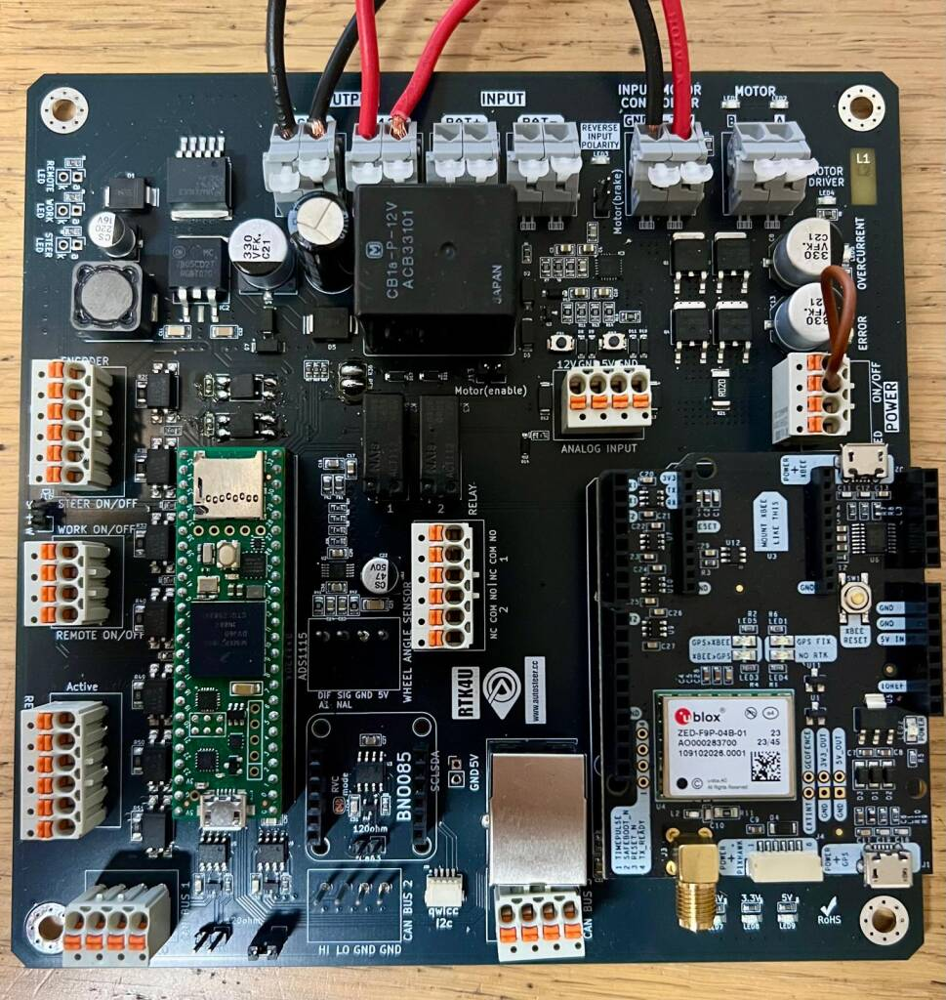

## Inhalt

- [PCB-Details](#pcb-details)
- [Technische Daten](#technische-daten)
- [Anschlüsse](#anschlüsse)
  - [USB](#usb-anschluss) · [Spannungsversorgung](#spannungsversorgung-der-platine) · [Einschalter](#einschalter-onoff) · [Eingänge](#eingänge)
  - [Lenkwinkelsensor](#lenkwinkelsensor) · [Analogeingänge](#12-v--und-5-v-analogeingänge) · [CAN-Bus](#can-bus)
  - [Kompass und Neigungssensor](#kompass-und-neigungssensor) · [GNSS-Receiver](#gnss-receiver) · [Ethernet](#ethernet-anschluss)
  - [Relais](#relais) · [Motor Enable/Brake-Jumper](#motor-enablebrake-jumper)
- [Webinterface](#webinterface)
- [Firmware-Update](#firmware-update)

## PCB-Details

- Arduino Teensy 4.1 mit Ethernet
- ADS1115 (verlötet)
- Steckplätze für Ardusimple simpleRTK2B, Septentrio und Bynav
- Motorcontroller integriert
- Verpolschutz
- Schutz der Eingänge mit Optokoppler
- I2C über Wago- und QWIIC-Stecker
- 2 Relais
- Webinterface

## Technische Daten

**Versorgungsspannung:** 12–15 V, direkt nach dem Stecker am Traktor mit 10 A absichern.

**Eingänge**
- Ein/Aus-Schalter
- 4 Digitaleingänge (3 + 1 Interrupt), potentialfrei (GND auf GND) – Schalter für Lenken, Arbeit, Remote
- 3 × 12-V-Eingänge für Lenken, Arbeit, Remote
- Lenkwinkelsensor
- 1 × analog 0–5 V
- 1 × analog 0–12 V

**Ausgänge**
- 5 V, max. 800 mA
- 12 V (Eingangsspannung), max. 2 A
- Ausgang für den Motorcontroller (= Eingangsspannung)
- 3 × CAN-Bus
- Ethernet zum Betrieb
- 2 Relais
- I2C-Bus

**Elektrische Daten**

| | |
|---|---|
| Versorgung | 12–15 V DC |
| Stromaufnahme | 200 mA bei 13,0 V (ohne Motor) |
| Ausgänge | 5 V DC und 12 V DC |
| Abmessungen (L × B × H) | 160 × 120 × 35 mm |
| Arbeitstemperatur | −40 °C bis +85 °C |
| Lagertemperatur | −40 °C bis +85 °C |
| Normen | RoHS-konform |

## Anschlüsse

### USB-Anschluss

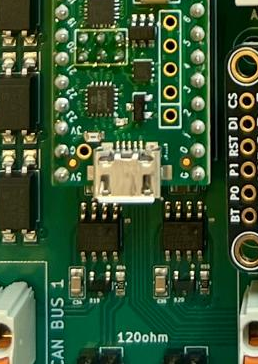

Der USB-Anschluss am Teensy wird nur zum Programmieren benötigt. Firmware-Updates gehen auch über Ethernet
(siehe [Firmware-Update](#firmware-update)).

### Spannungsversorgung der Platine

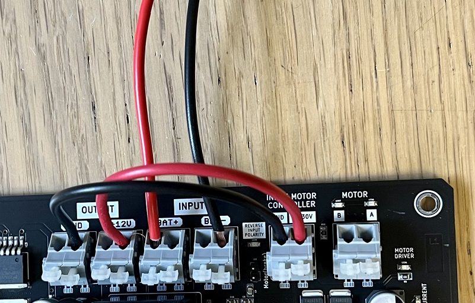

12 V vom Traktor (die Spannung am Traktor liegt zwischen 12 und 14 V), **mit 10 A absichern**.

- Die Sicherung sitzt immer direkt am Stecker und schützt die Leitung. Nimmt man den Strom direkt an der Batterie,
  gehört die Sicherung dorthin; bei der 3-poligen Traktorsteckdose sofort beim Stecker.
- Beschriftung **INPUT BAT+** und **BAT−**.
- Die Brücke von **Output** zu **Input M** versorgt den Motorcontroller mit Strom, nachdem das Relais angezogen hat.
- Zwischen Output und Input Motorcontroller kann ein 12-V-auf-24-V-StepUp eingesetzt werden, um den Motor mit 24 V
  zu betreiben (dreht schneller).
- **Motor A und B** ist der Anschluss für den Lenkmotor. Hier kann auch ein 0–12-V-Proportionalventil angeschlossen
  werden (+ je Seite auf Motor A und B, Masse vom Traktor nehmen).

### Einschalter ON/OFF

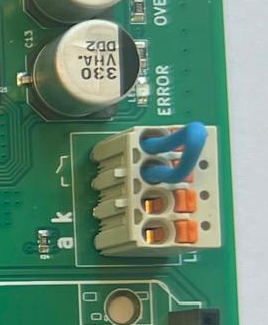

Die Brücke bei ON/OFF schaltet das Board ein – das schwarze Relais zieht an, und der Motorcontroller bzw. der
12-V-Ausgang hat Strom. Hier kann ein externer Schalter verbaut werden. Daneben ist ein Anschluss für eine LED.

### Eingänge

#### Steer on/off – S auf GND

Schalter zum Aktivieren der Lenkung (potentialfrei, Masse auf Masse). Dieser Kontakt gibt das Lenken frei. Er kann
z. B. über einen Mikroschalter am Motor geführt werden, der beim Wegklappen den Motor ausschaltet.

**Der Switch muss in AgOpenGPS in der Modul-Konfiguration auf „Switch“ eingestellt werden!**
Ein grüner Punkt = Lenken aktiv = Schalter geschlossen.

Traktor-Symbol: **grün** Lenken aktiviert · **rot** Lenken aus · **orange** keine Spur

#### Work on/off – W auf GND

Schalter zum Aktivieren der Aufzeichnung (potentialfrei, Masse auf Masse). Muss in der AgOpenGPS-Konfiguration
entsprechend eingestellt werden.

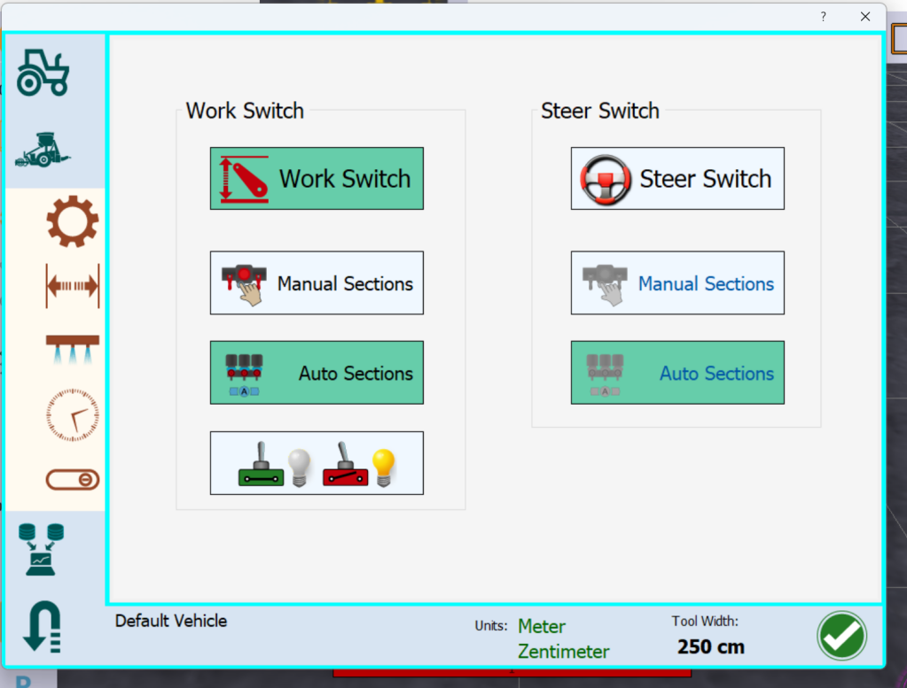

#### Brücke S+W

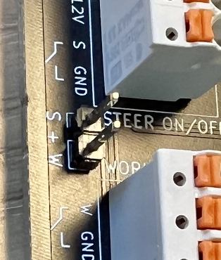

Aktiviert die Aufzeichnung gemeinsam mit dem Lenken.

#### 12-V-Eingänge für Work/Steer

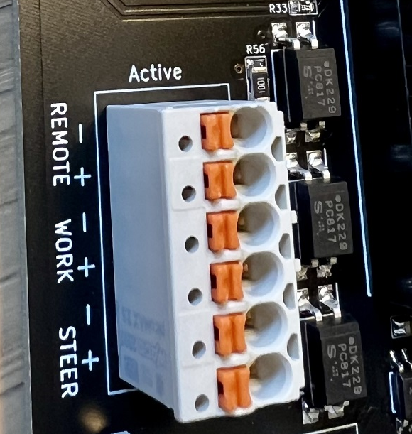

Will man Steer, Work oder Remote mit einem 12-V-Signal aktivieren, benutzt man diese Anschlüsse.
**Achtung: Es müssen immer 12 V und GND vom externen Schalter verwendet werden!**

### Lenkwinkelsensor

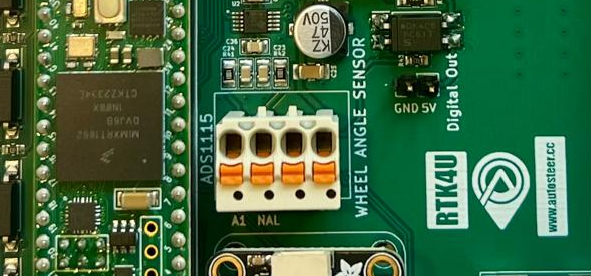

- **5 V** und **GND** als Versorgung für den Sensor, das Signal des Sensors auf **Signal**.
- Bei einem bestehenden Lenkwinkelsensor das Signal vorher mit einem Multimeter prüfen:
  **maximal 5 V** – üblich ist ein Bereich von 0,5–4,5 V.
- Die meisten Sensoren haben einen bestimmten Messbereich (meist direkt beim Stecker oder genau gegenüber) – auch
  das vorher prüfen.
- Bei vorgerüsteten Sensoren braucht man nur GND und Signal vom Sensor: Signal auf **Signal**, GND wird mit **A1**
  verbunden. Die Software liest dann differentiell (A/D-Wandler ADS1115).

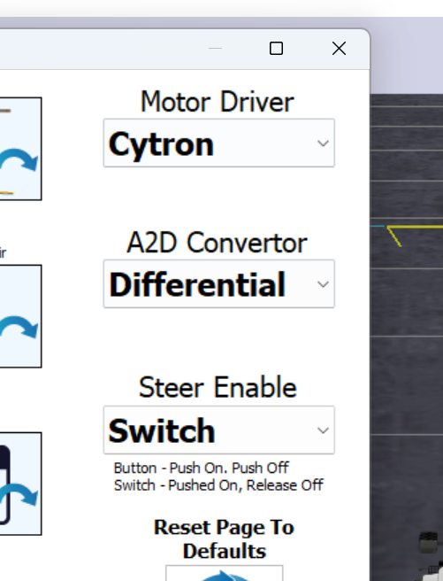

Anbindung Kompass und Neigungssensor: Das interne Modul wird über den QWIIC-Stecker mit der Hauptplatine oder der
Relaisplatine verbunden.

### 12-V- und 5-V-Analogeingänge

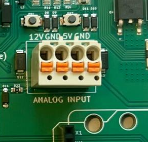

| Eingang | Teensy-Pin |
|---|---|
| Drucksensor 0–5 V | 24 |
| 12-V-Eingang | 27 |

Die Eingänge gehen über Spannungsteiler auf diese Teensy-Pins. Die Funktion des 12-V-Eingangs (Lenkschalter,
Arbeitsschalter, Drucksensor) und die Schaltschwelle werden im Webinterface eingestellt.

**Stromsensor:** ist direkt mit dem Motorcontroller verbunden und kann in AgOpenGPS aktiviert werden.

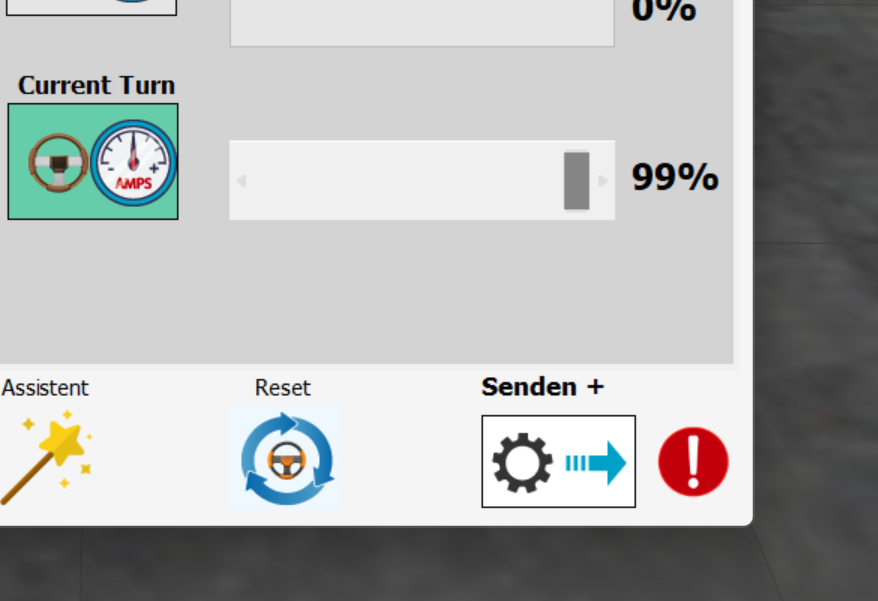

### CAN-Bus

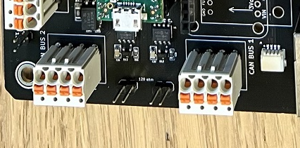

Je CAN-Bus ist ein 120-Ω-Abschlusswiderstand auf der Platine verbaut; er ist aktiv, wenn der Jumper gesteckt ist.
Für Allynav-Motoren wird ein Jumper empfohlen und mitgeliefert.

### Kompass und Neigungssensor

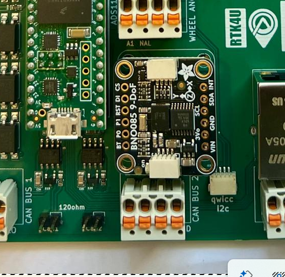

UART im **RVC-Modus** – wird unterstützt und ist der Standard für den BNO085. Wird der Kompass inkl. Montage
bestellt, wird er fix auf der Platine verbaut.

### GNSS-Receiver

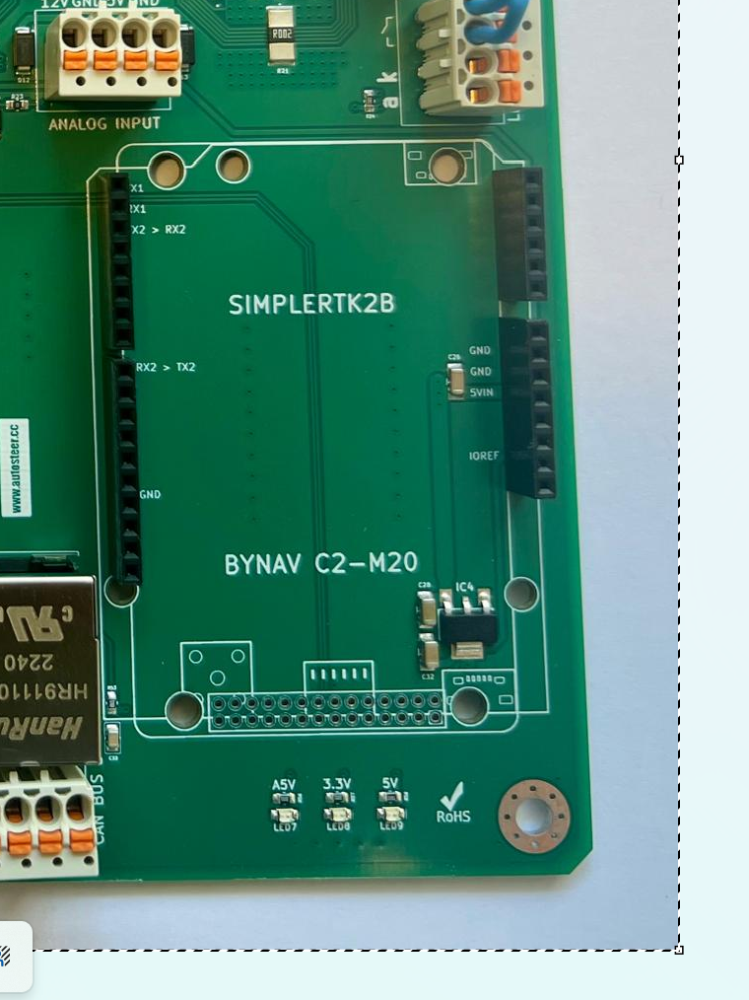

Steckplatz im UNO-Format für Septentrio oder F9P (Single). Für Bynav-Receiver wird ein Adapterboard mitgeliefert.

### Ethernet-Anschluss

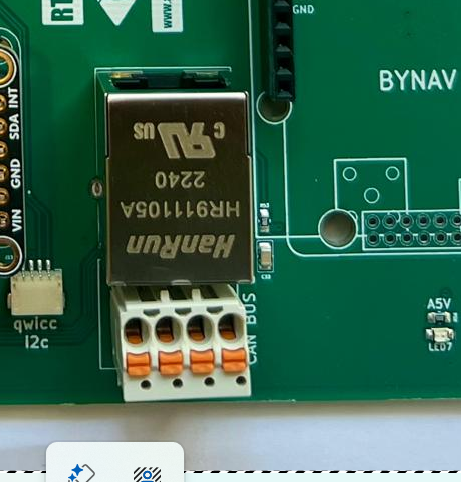

Hier das Netzwerkkabel anschließen.

### Relais

Die Funktion der beiden Relais wird im Webinterface eingestellt.

### Motor Enable/Brake-Jumper

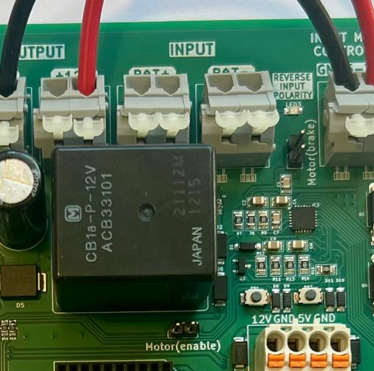

Bei Verwendung eines DC-Motors muss ein Jumper auf einem der beiden Steckplätze sitzen.

- **Enable** (Auslieferung): Die zwei Tasten sind nicht aktiv, der Motorcontroller muss erst von AgOpenGPS aktiviert
  werden. Vorteil: Im Leerlauf hat der Motorcontroller keine Bremswirkung (Widerstand).
- **Brake**: Controller immer aktiv, bremst im Stillstand, Tasten benutzbar.

## Webinterface

Im Browser die IP-Adresse des Controllers öffnen (`http://<IP-des-Controllers>`). Dort werden Motor, CAN-Marke,
Relais, Eingänge usw. eingestellt und Live-Werte angezeigt. Der Button **Anleitung** führt zu dieser Seite.

## Firmware-Update

Über das Webinterface im Bereich **Firmware** – siehe [Update](../README.md#update).
