# AIO-Controller – PCB Version 2026

AgOpenGPS AIO-Controller von [www.autosteer.cc](https://www.autosteer.cc) (Teensy 4.1).

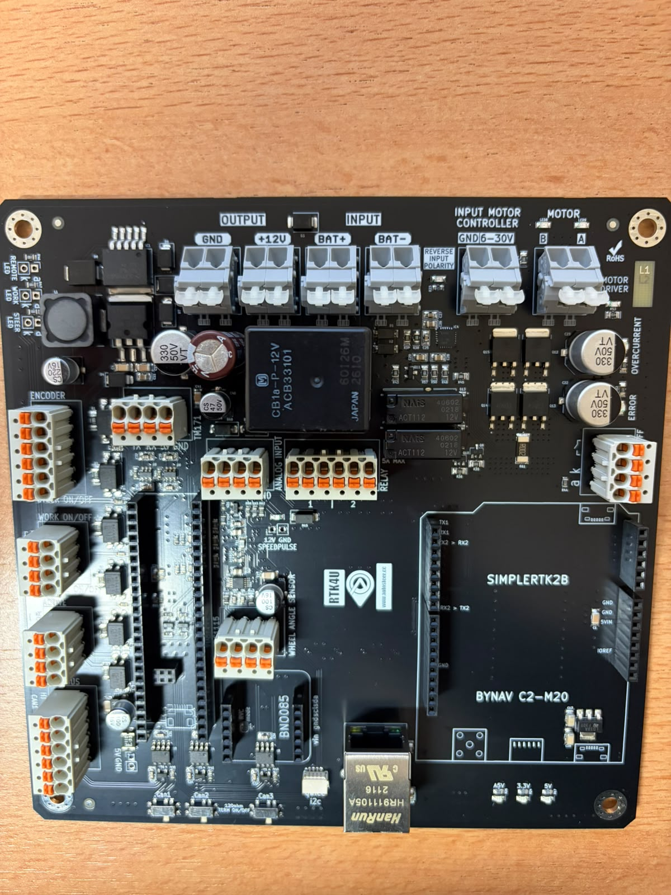

## Inhalt

- [Die Box](#die-box)
  - [Box öffnen](#box-öffnen) · [Zuleitungen](#zuleitungen) · [Antenne](#antenne)
- [Einbau der PCB](#einbau-der-pcb)
  - [Dual-System](#dual-system-2-antennen) · [Single-System](#single-system-1-antenne-und-imu)
- [PCB-Details](#pcb-details)
- [Technische Daten](#technische-daten)
- [Anschlüsse](#anschlüsse)
  - [Übersicht](#übersicht-der-anschlüsse)
  - [USB](#usb-anschluss) · [Spannungsversorgung](#spannungsversorgung-der-platine) · [Einschalter](#einschalter-onoff) · [Eingänge](#eingänge)
  - [Lenkwinkelsensor](#lenkwinkelsensor) · [Analogeingänge](#12-v--und-5-v-analogeingänge) · [CAN-Bus](#can-bus)
  - [Kompass und Neigungssensor](#kompass-und-neigungssensor) · [GNSS-Receiver](#gnss-receiver) · [Ethernet](#ethernet-anschluss)
  - [Relais](#relais)
- [Ethernet-Einstellungen am PC](#ethernet-einstellungen-am-pc)
- [AgIO Netzwerkeinstellungen](#agio-netzwerkeinstellungen)
  - [WLAN bricht ab](#wlan-verbindung-bricht-ab-sobald-agio-verbunden-ist)
- [Webinterface](#webinterface)
  - [DUAL GNSS](#dual-gnss) · [MCP23017 Relay Card](#mcp23017-relay-card)
  - [Motor Controller](#motor-controller) · [Motor Test](#motor-test) · [CAN-Bus-Lenkung](#can-bus-lenkung) · [Analog 12V](#analog-12v)
  - [PCB Relay Function](#pcb-relay-function) · [Kick PWM und Kick Dauer](#kick-pwm-und-kick-dauer) · [Gyro WAS (in Entwicklung)](#gyro-was-in-entwicklung)
- [Firmware-Update](#firmware-update)

## Die Box

Die Platine kommt fertig vorverkabelt in einer Box.

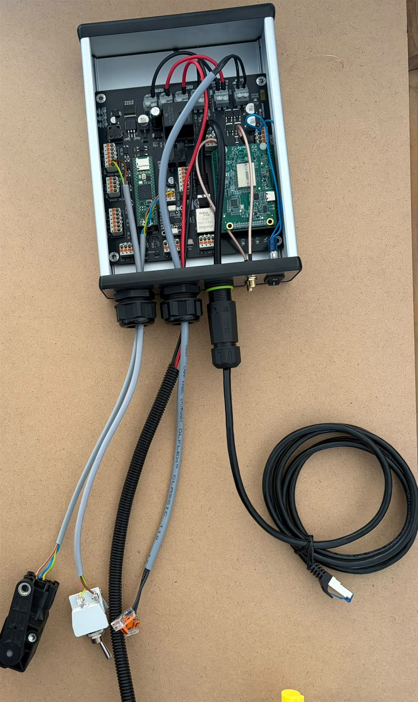

### Box öffnen

Eine Seite und die oberen Schrauben lösen, dann lässt sich der Deckel abschieben.

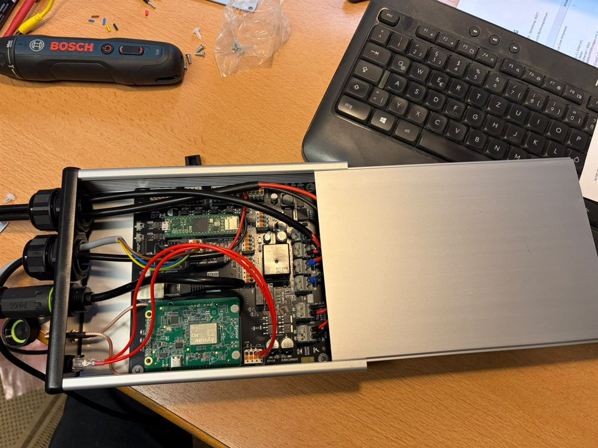

### Zuleitungen

#### PCB-Zuleitung: schwarz, 2 × 2,5 mm²

Anschluss am besten an der 3-poligen Steckdose. Die Sicherung gleich nach dem Stecker einbauen.

#### Motor-Zuleitung: schwarz, 2 × 1,5 mm²

Der Anschluss am Motor ist egal – die Drehrichtung kann in AgOpenGPS umgedreht werden (**Motor invertieren** in den
Lenkeinstellungen, siehe [Einbau der PCB](#single-system-1-antenne-und-imu)).

Auf der Platine befindet sich ein Stromsensor. Er wird in den Lenkeinstellungen unter **Stromsensor Lenkung** nach
Bedarf aktiviert. Zieht der Motor zu viel Strom, deaktiviert sich die Lenkung.

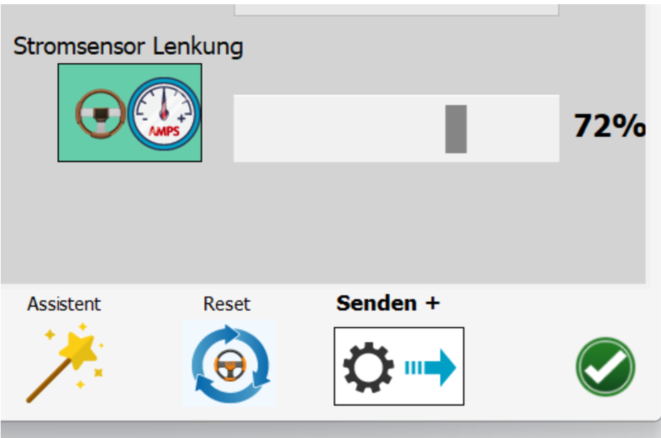

#### Ein/Aus-Schalter

Aktiviert die Platine. Bei Nichtgebrauch die Platine am besten über die Zuleitung vom Traktor trennen.

#### Lenkwinkelsensor: grau, 3 × 0,5 mm²

- **Braun:** 5 V
- **Grün-gelb:** GND
- **Blau:** Signal vom Sensor (0–5 V)

Die Richtung wird in den Lenkeinstellungen mit **LWS invertieren** umgedreht.

#### Lenkung aktivieren: schwarz, 2 × 0,5 mm²

Kann mit einem Schalter oder einem Taster verwendet werden, in den Lenkeinstellungen unter **Externe Aktivierung**
einstellen:

- **Schalter** (rastend): Ein = Lenkung an, Aus = Lenkung aus
- **Taster** (tastend): jedes Drücken ändert den Status – einmal drücken an, nochmal drücken aus

### Antenne

- Bei zwei Antennen in AgOpenGPS unter **Antenna Type** **Dual** auswählen. Fährt der Traktor verkehrt, einfach die
  beiden Antennenkabel umstecken.
- Mindestabstand bei Dual 1 m – je größer, desto besser.
- Vibrationen vermeiden und die Kabel nicht am Auspuff vorbeiführen.

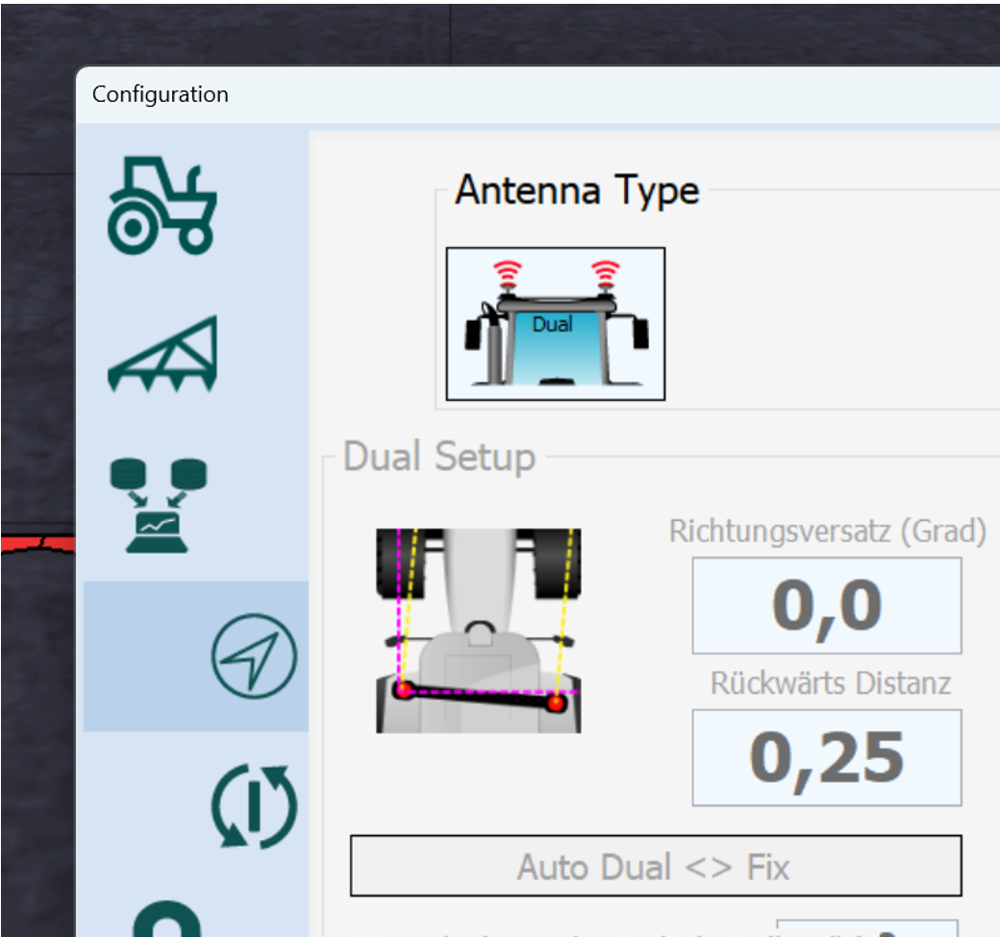

## Einbau der PCB

### Dual-System (2 Antennen)

Die Position der Platine im Traktor ist egal.

### Single-System (1 Antenne und IMU)

Die Platine muss halbwegs eben und im rechten Winkel zur Fahrtrichtung eingebaut werden. Die Ausrichtung ist egal –
sie wird nachher in AgOpenGPS eingestellt.

In den **Lenkeinstellungen** (der blaue Pfeil macht das Fenster groß) unter **IMU Achse** die X- oder Y-Achse wählen:

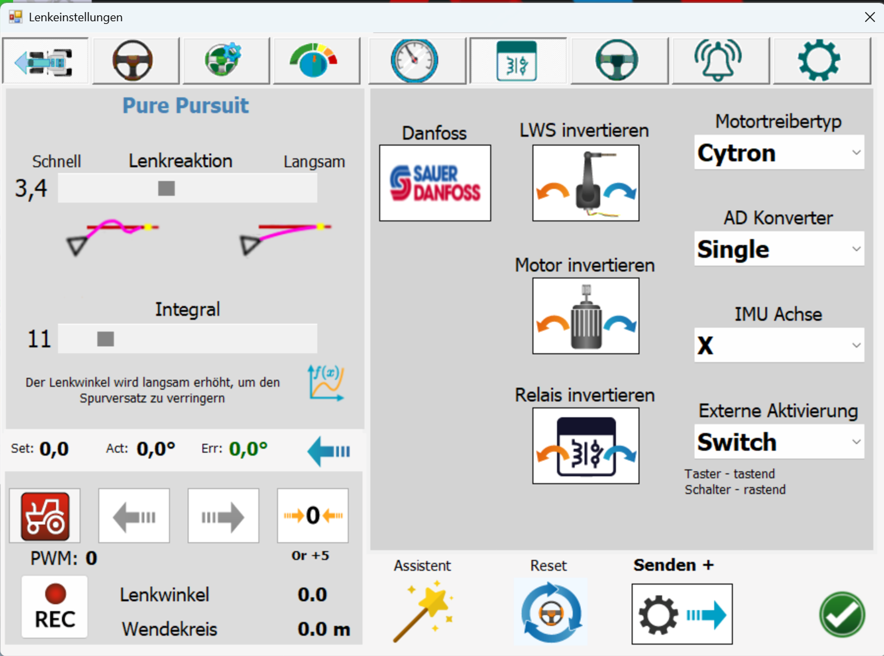

Die Nullstellung (eben) und das Invertieren der Neigung werden in der **Configuration** im Bereich IMU eingestellt
(**Versatz entfernen**, **IMU kalibrieren**, **IMU invertieren**):

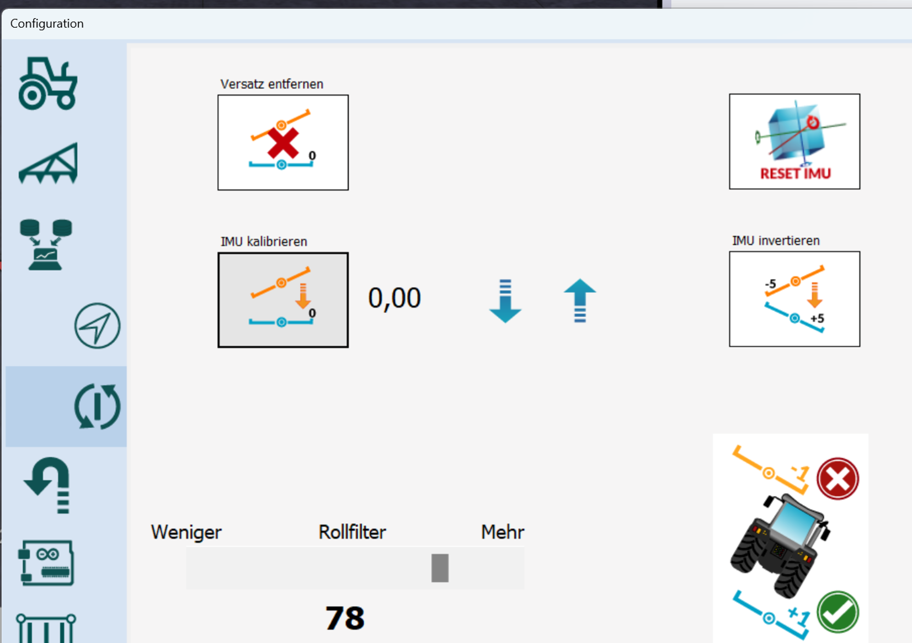

## PCB-Details

- Arduino Teensy 4.1 mit Ethernet
- ADS1115 (verlötet)
- Steckplätze für Ardusimple simpleRTK2B, Septentrio und Bynav
- Motorcontroller integriert
- Verpolschutz
- Schutz der Eingänge mit Optokoppler
- I2C über Wago- und QWIIC-Stecker
- 2 Relais
- Webinterface

## Technische Daten

**Versorgungsspannung:** 12–15 V, direkt nach dem Stecker am Traktor mit 10 A absichern.

**Eingänge**
- Ein/Aus-Schalter
- 4 Digitaleingänge (3 + 1 Interrupt), potentialfrei (GND auf GND) – Schalter für Lenken, Arbeit, Remote
  (derzeit ohne Funktion) und Encoder
- 2 × 12-V-Eingänge für Lenken und Arbeit
- Lenkwinkelsensor
- 1 × analog 0–5 V
- 1 × analog 0–12 V

**Ausgänge**
- 5 V, max. 800 mA
- 12 V (Eingangsspannung), max. 2 A
- Ausgang für den Motorcontroller (= Eingangsspannung)
- 3 × CAN-Bus
- Ethernet zum Betrieb
- 2 Relais
- I2C-Bus

**Elektrische Daten**

| | |
|---|---|
| Versorgung | 12–15 V DC |
| Stromaufnahme | 200 mA bei 13,0 V (ohne Motor) |
| Ausgänge | 5 V DC und 12 V DC |
| Abmessungen (L × B × H) | 160 × 120 × 35 mm |
| Arbeitstemperatur | −40 °C bis +85 °C |
| Lagertemperatur | −40 °C bis +85 °C |
| Normen | RoHS-konform |

## Anschlüsse

### Übersicht der Anschlüsse

Beschriftung wie auf der Platine.

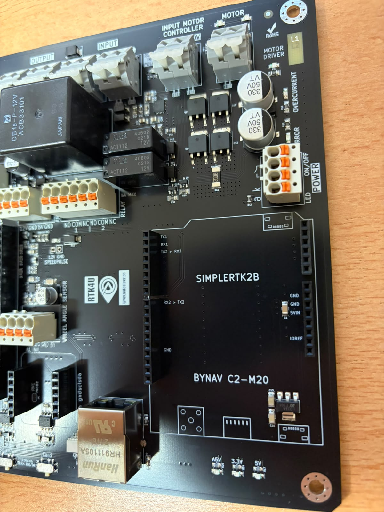

| Anschluss | Klemmen | Funktion |
|---|---|---|
| INPUT | BAT+ · BAT− | Versorgung 12 V vom Traktor (10 A absichern). LED **REVERSE INPUT POLARITY** = verpolt |
| OUTPUT | GND · +12V | geschaltete 12 V nach dem Relais (Brücke zu INPUT MOTOR CONTROLLER) |
| INPUT MOTOR CONTROLLER | GND · 6–30V | Versorgung des Motorcontrollers |
| MOTOR | B · A | Lenkmotor bzw. Proportionalventil; LEDs zeigen die Drehrichtung, dazu LEDs **OVERCURRENT** und **ERROR** |
| POWER | ON/OFF · LED (a, k) | Einschalter (Brücke) und LED |
| RELAY | NO · COM · NC (Relais 1 und 2) | 2 Relais, max. 5 A |
| ANALOG INPUT | 12V · GND · 5V · GND | 0–12-V- und 0–5-V-Analogeingang |
| TM171 | TX · RX · 5V · GND | serielle Schnittstelle – wird derzeit von der Firmware noch nicht unterstützt (folgt) |
| WHEEL ANGLE SENSOR | DIF (A1) · SIG · GND · 5V | Lenkwinkelsensor |
| SPEEDPULSE | 12V · GND (Lötpunkte) | Geschwindigkeitssignal |
| BNO085 | Steckplatz, Lötbrücke RVC mode | Kompass und Neigungssensor |
| qwiic i2c | vin · gnd · scl · sda | I2C (z. B. Relaiskarte MCP23017) |
| SIMPLERTK2B / BYNAV C2-M20 | Steckplatz | GNSS-Receiver |
| Ethernet | RJ45 | Netzwerk zu AgOpenGPS |
| Status-LEDs | A5V · 3.3V · 5V | Versorgungsspannungen auf der Platine |

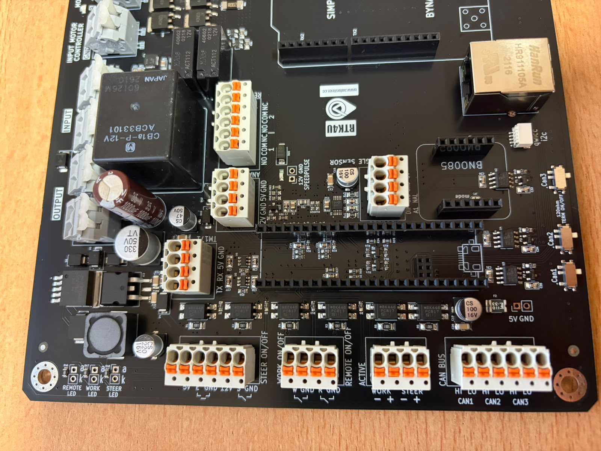

| Anschluss | Klemmen | Funktion |
|---|---|---|
| STEER ON/OFF | 5V · E · GND · 12V · S · GND | E–GND = Encoder-Eingang, S–GND = Lenkschalter (potentialfrei), 12V = 12-V-Ausgang (dazu die Lötbrücke auf der Rückseite der Platine schließen) |
| WORK ON/OFF · REMOTE ON/OFF | W · GND · R · GND | W–GND = Arbeitsschalter, R–GND = Remote (derzeit ohne Funktion), potentialfrei |
| ACTIVE | WORK − + · STEER − + | Work und Steer mit 12 V schalten (Optokoppler) |
| CAN BUS | HI · LO für CAN1, CAN2, CAN3 | 3 CAN-Busse |
| Can1 · Can2 · Can3 | Schiebeschalter „120ohm TERM ON/OFF“ | Abschlusswiderstand je CAN-Bus |
| REMOTE LED · WORK LED · STEER LED | a · k (Lötpunkte) | Anschluss für externe LEDs |
| 5V GND | Lötpunkte | 5-V-Ausgang |

### USB-Anschluss

Der USB-Anschluss am Teensy wird nur zum Programmieren benötigt. Firmware-Updates gehen auch über Ethernet
(siehe [Firmware-Update](#firmware-update)).

### Spannungsversorgung der Platine

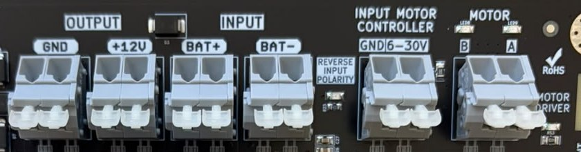

12 V vom Traktor (die Spannung am Traktor liegt zwischen 12 und 14 V), **mit 10 A absichern**.

- Die Sicherung sitzt immer direkt am Stecker und schützt die Leitung. Nimmt man den Strom direkt an der Batterie,
  gehört die Sicherung dorthin; bei der 3-poligen Traktorsteckdose sofort beim Stecker.
- Beschriftung **INPUT BAT+** und **BAT−**.
- Die Brücke von **Output** zu **Input M** versorgt den Motorcontroller mit Strom, nachdem das Relais angezogen hat.
- Zwischen Output und Input Motorcontroller kann ein 12-V-auf-24-V-StepUp eingesetzt werden, um den Motor mit 24 V
  zu betreiben (dreht schneller).
- **Motor A und B** ist der Anschluss für den Lenkmotor. Hier kann auch ein 0–12-V-Proportionalventil angeschlossen
  werden (+ je Seite auf Motor A und B, Masse vom Traktor nehmen).
- Der Motorcontroller wird vom Teensy aktiviert. Eine Bremsfunktion im Stillstand gibt es nicht.

### Einschalter ON/OFF

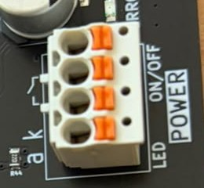

Die Brücke bei ON/OFF schaltet das Board ein – das schwarze Relais zieht an, und der Motorcontroller bzw. der
12-V-Ausgang hat Strom. Hier kann ein externer Schalter verbaut werden. Daneben ist ein Anschluss für eine LED.

### Eingänge

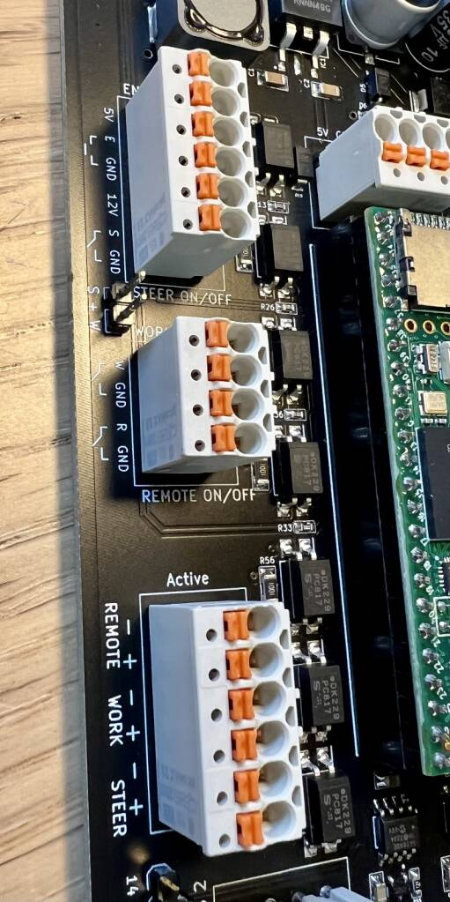

Die Schalter an **S**, **W** und **R** sind potentialfrei und werden gegen **GND** geschaltet. Mit 12 V schaltet man
Work und Steer über die Klemmen **ACTIVE** (siehe unten). **R** (Remote) hat derzeit keine Funktion,
**E**–**GND** ist der Encoder-Eingang.

#### Steer on/off – S auf GND

Schalter zum Aktivieren der Lenkung (potentialfrei, Masse auf Masse). Dieser Kontakt gibt das Lenken frei. Er kann
z. B. über einen Mikroschalter am Motor geführt werden, der beim Wegklappen den Motor ausschaltet.

**Der Switch muss in AgOpenGPS in der Modul-Konfiguration auf „Switch“ eingestellt werden!**
Ein grüner Punkt = Lenken aktiv = Schalter geschlossen.

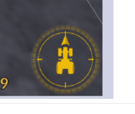

Traktor-Symbol: **grün** Lenken aktiviert · **rot** Lenken aus · **orange** keine Spur

#### Work on/off – W auf GND

Schalter zum Aktivieren der Aufzeichnung (potentialfrei, Masse auf Masse). Muss in der AgOpenGPS-Konfiguration
entsprechend eingestellt werden.

#### 12-V-Eingänge für Work/Steer (ACTIVE)

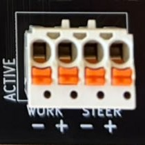

Will man Work oder Steer mit einem 12-V-Signal aktivieren, legt man an **WORK − +** bzw. **STEER − +** die
Spannung an (+ auf +, − auf −).
**Achtung: Es müssen immer 12 V und GND vom externen Schalter verwendet werden!**

### Lenkwinkelsensor

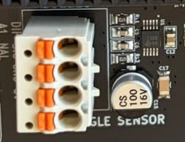

- **5 V** und **GND** als Versorgung für den Sensor, das Signal des Sensors auf **Signal**.
- Bei einem bestehenden Lenkwinkelsensor das Signal vorher mit einem Multimeter prüfen:
  **maximal 5 V** – üblich ist ein Bereich von 0,5–4,5 V.
- Die meisten Sensoren haben einen bestimmten Messbereich (meist direkt beim Stecker oder genau gegenüber) – auch
  das vorher prüfen.
- Bei vorgerüsteten Sensoren braucht man nur GND und Signal vom Sensor: Signal auf **Signal**, GND wird mit **A1**
  verbunden. Die Software liest dann differentiell (A/D-Wandler ADS1115).

### 12-V- und 5-V-Analogeingänge

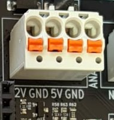

- Drucksensor 0–5 V
- 12-V-Eingang 0–12 V

Die Eingänge gehen über Spannungsteiler auf den Teensy. Die Funktion des 12-V-Eingangs (Lenkschalter,
Arbeitsschalter, Drucksensor) und die Schaltschwelle werden im Webinterface eingestellt.

**Stromsensor:** ist direkt mit dem Motorcontroller verbunden und kann in AgOpenGPS aktiviert werden.

### CAN-Bus

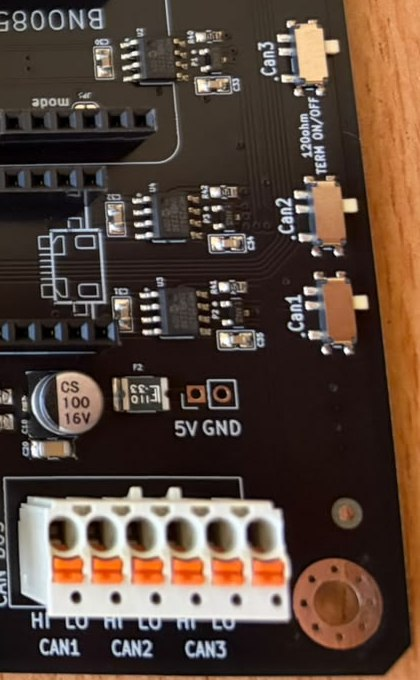

Je CAN-Bus ist ein 120-Ω-Abschlusswiderstand auf der Platine verbaut. Er wird mit dem Schiebeschalter
**Can1**, **Can2** bzw. **Can3** („120ohm TERM ON/OFF“) neben der Ethernet-Buchse eingeschaltet.
Für Allynav-Motoren den Abschlusswiderstand an CAN2 einschalten.

### Kompass und Neigungssensor

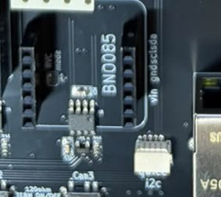

UART im **RVC-Modus** – wird unterstützt und ist der Standard für den BNO085. Wird der Kompass inkl. Montage
bestellt, wird er fix auf der Platine verbaut.

Daneben liegt der QWIIC-Stecker (**qwiic i2c**) für I2C-Geräte, z. B. die Relaiskarte.

### GNSS-Receiver

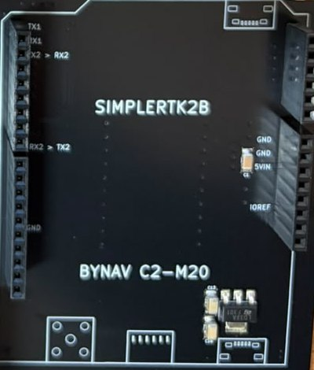

Steckplatz im UNO-Format für Septentrio oder F9P (Single). Für Bynav-Receiver wird ein Adapterboard mitgeliefert.

### Ethernet-Anschluss

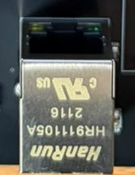

Hier das Netzwerkkabel anschließen.

### Relais

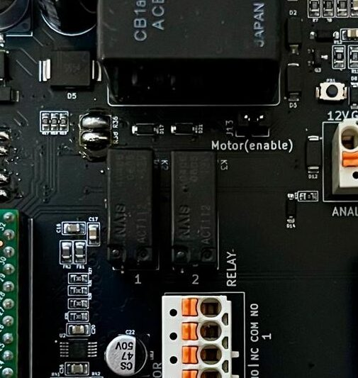

Je Relais drei Klemmen, max. 5 A:

- **COM**: Eingang für die Spannung, die geschaltet werden soll
- **NO** (normally open): bekommt die Spannung, wenn das Relais angezogen hat
- **NC** (normally closed): bekommt die Spannung, wenn das Relais abgefallen ist

COM wird also zwischen NC und NO umgeschaltet.

Die Funktion der beiden Relais wird im Webinterface unter **PCB Relay 1 Function** bzw. **PCB Relay 2 Function**
eingestellt (siehe [PCB Relay Function](#pcb-relay-function)).

## Ethernet-Einstellungen am PC

Bei Verwendung eines Routers muss vorerst nichts eingestellt werden. Bei einer Direktverbindung mit einem Tablet muss
die IP-Adresse des Ethernet-Adapters am Tablet fix eingestellt werden. Siehe auch
[AgOpenGPS Ethernet Setup](https://docs.agopengps.com/software/05.-Ethernet-Setup/).

Rechtsklick auf das Netzwerk-Symbol in der Taskleiste → **Netzwerk- und Interneteinstellungen**:

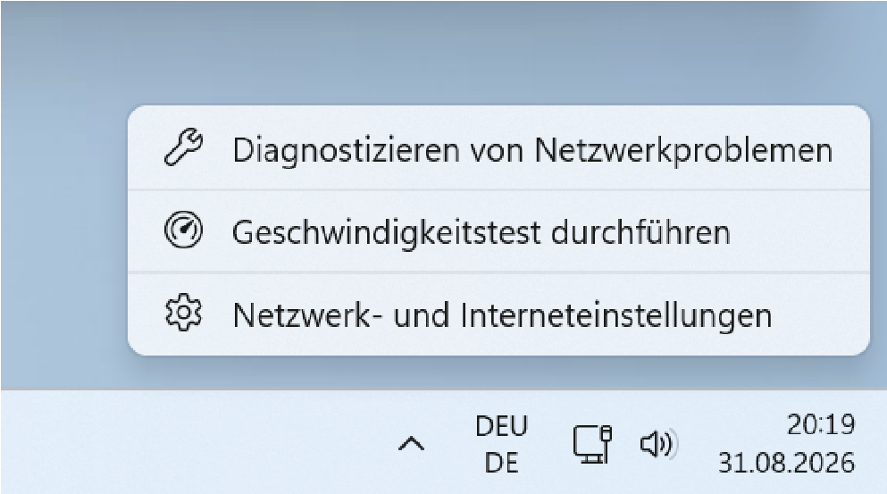

**Ethernet** wählen, bei **IP-Zuweisung** auf **Bearbeiten** drücken:

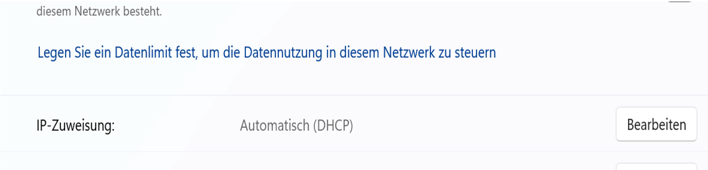

**Manuell** wählen und **IPv4** einschalten:

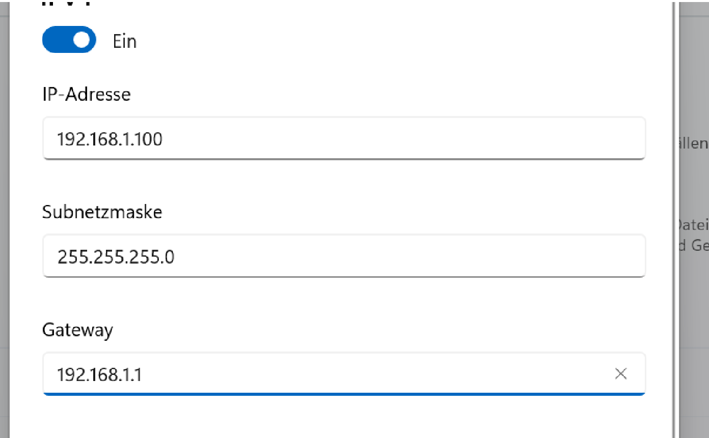

- **IP-Adresse:** 192.168.1.100 – das ist die Adresse des Tablets
- **Subnetzmaske:** 255.255.255.0 – fragt Windows stattdessen nach der **Präfixlänge**, dort 24 eintragen
- **Gateway:** 192.168.1.1

## AgIO Netzwerkeinstellungen

In AgIO auf das Netzwerk-Symbol drücken (steht auf **Off**):

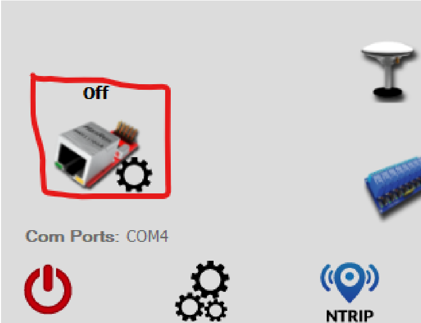

Im Fenster **Ethernet Configuration** auf **UDP On** drücken (wird grün), dann auf den grünen Haken:

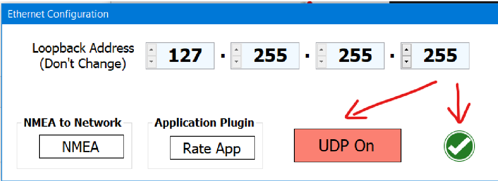

Das Netzwerk-Symbol ist jetzt grün, darüber stehen die IP-Adressen des PCs. Neuerlich auf das Netzwerk-Symbol klicken:

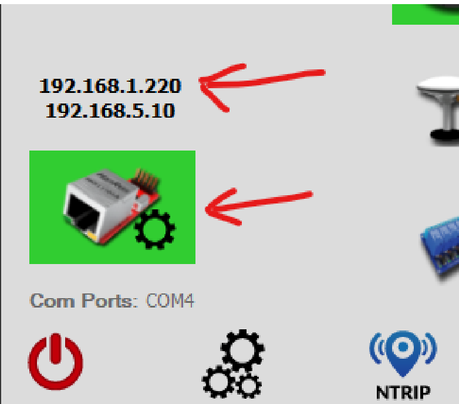

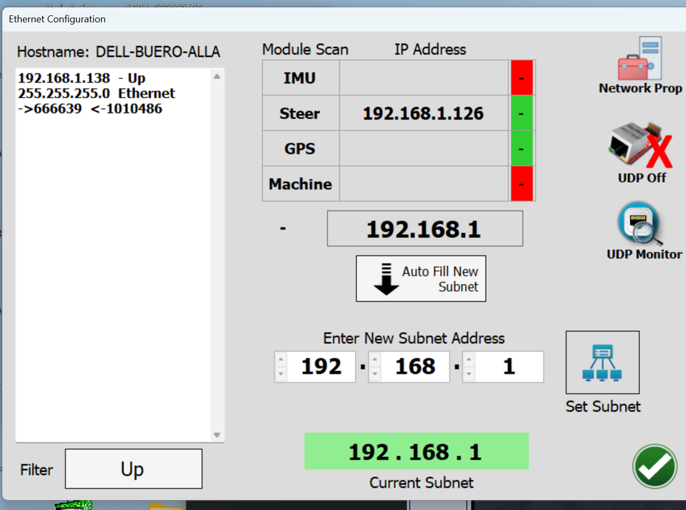

- **IMU** (nur bei Single mit IMU), **Steer** und **GPS** sollten grün sein. Bei Steer wird die IP der Platine
  angezeigt.
- **Current Subnet** sollte mit dem Netz übereinstimmen, das zuvor am PC eingestellt wurde. Sonst unter
  **Enter New Subnet Address** die Adresse einstellen und **Set Subnet** drücken – das Subnetz wird dann an die
  Platine übertragen.

Die Platine ist ab Werk auf **192.168.1.126** eingestellt, der PC braucht also eine Adresse 192.168.1.xxx.

Weitere Einstellungen der Platine (Motor, Relais usw.) siehe [Webinterface](#webinterface).

### WLAN-Verbindung bricht ab, sobald AgIO verbunden ist

Windows gibt der Kabelverbindung den Vorzug vor dem WLAN und schaltet das WLAN ab. Für AgOpenGPS werden aber beide
gebraucht. Abhilfe ist eine kleine Änderung in der Windows-Registrierung: Die Datei
[Network-Drop-Fix.reg](https://raw.githubusercontent.com/AgOpenGPS-Official/Boards/main/Misc/Network-Drop-Fix.reg)
herunterladen und per Doppelklick importieren, oder die Änderung selbst nach
[dieser Anleitung](https://discourse.agopengps.com/t/toughpad-book/399/110) vornehmen.

## Webinterface

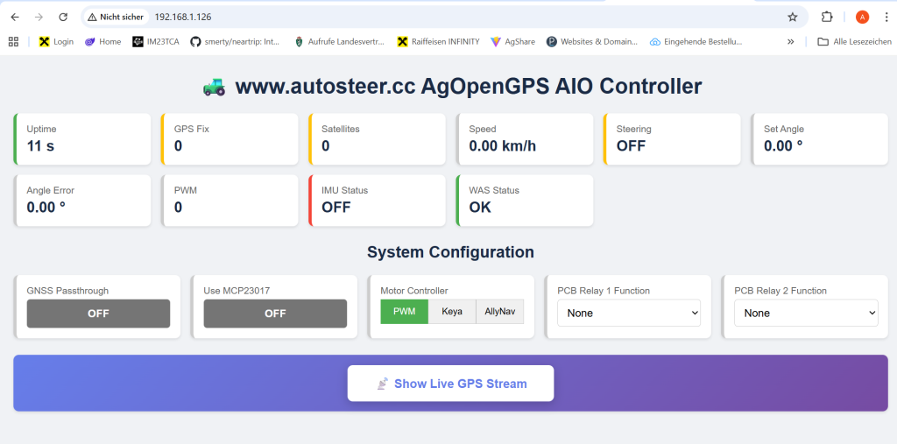

Im Browser die IP-Adresse des Controllers öffnen (`http://<IP-des-Controllers>`). Dort werden Motor, CAN-Marke,
Relais, Eingänge usw. eingestellt und Live-Werte angezeigt. Der Button **Anleitung** führt zu dieser Seite.
Einstellungen wirken sofort und bleiben nach dem Ausschalten gespeichert.

### DUAL GNSS

- **Ein:** Alle Daten vom GNSS-Receiver werden **1:1 an AgOpenGPS weitergeleitet** (UDP-Port 9999), ohne Auswertung im
  Controller. Für Receiver, die selbst Position und Heading liefern (z. B. Dual-Antennen-Receiver).
- **Aus:** Der Controller liest GGA/VTG des Receivers (z. B. F9P Single) und schickt sie zusammen mit Kompass und
  Neigung (BNO085) an AgOpenGPS.

### MCP23017 Relay Card

Aktiviert die optionale **Relaiskarte für 8 Teilbreiten** (I2C-Portexpander MCP23017). Die Relais 1–8 folgen den
Teilbreiten 1–8 aus AgOpenGPS. Wird die Karte beim Start nicht gefunden, zeigt die Live-Ansicht „MCP23017 NOT FOUND“.

### Motor Controller

| Einstellung | Motor | Anschluss |
|---|---|---|
| PWM | integrierter Motorcontroller (DC-Motor oder Proportionalventil) | Motor A/B |
| Keya | Keya-Lenkmotor | CAN2, **250 000 Baud** |
| AllyNav | Allynav-Lenkmotor | CAN2, Baudrate wählbar: **250 000 für den blauen**, **500 000 für den roten** Motor |
| CAN-Bus | Lenkventil des Traktors über CAN | siehe [CAN-Bus-Lenkung](#can-bus-lenkung) |

Bei Keya und AllyNav erscheint die Auswahl der Baudrate und der Motortest. Die Live-Ansicht zeigt, ob der Motor
erkannt wurde, Fehlermeldungen, Position sowie Soll- und Ist-Drehzahl. Der Motorstrom geht an AgOpenGPS und kann
dort als Stromsensor zum Abschalten der Lenkung beim Eingreifen ins Lenkrad genutzt werden.

### Motor Test

Nur bei Keya und AllyNav. Die Buttons **◀ Links 1s** und **Rechts 1s ▶** schalten den Motor ein, drehen ihn
**1 Sekunde mit ca. 10 %** in die gewählte Richtung und schalten ihn wieder aus. So lassen sich Anschluss,
Baudrate und Drehrichtung prüfen, ohne AgOpenGPS zu starten.

Der Test geht nur bei ausgeschalteter Autolenkung. Wird während des Tests die Lenkung aktiv, übernimmt sie sofort.

### CAN-Bus-Lenkung

Motor Controller **CAN-Bus** wählen, dann unter **CAN-Bus Brand** den Traktor. Die Karte **Anschlüsse** zeigt, welche
CAN-Busse belegt sind:

| Marke | Anschlüsse |
|---|---|
| Claas | CAN3 (V-Bus): Lenkung, Engage, Work-Switch |
| Valtra/MF | CAN3 (V-Bus): Lenkung, Engage · CAN1 (K-Bus): Engage-Button, Heckhubwerk |
| CaseIH | CAN3 (V-Bus): Lenkung, Engage · CAN1 (K-Bus): Engage, Heckhubwerk |
| Fendt | CAN3 (V-Bus): Lenkung · CAN1 (K-Bus): Armlehnen-Tasten · CAN2 (ISO-Bus): Engage |
| JCB | CAN3 (V-Bus): Lenkung, Engage |
| FendtOne | CAN3 (V-Bus): Lenkung (500 kBaud) · CAN1 (K-Bus): Engage (500 kBaud) |
| Lindner | CAN3 (V-Bus): Lenkung, Engage |
| AgOpenGPS | CAN3 (V-Bus): Lenkung + Lenkwinkel-Rückmeldung |
| Cat MT-Late | CAN3 (V-Bus): Lenkung, Engage, Rückwärts-Erkennung · CAN1 (K-Bus): Engage |
| Cat MT-Early | CAN3 (V-Bus): Lenkung, Engage, Rückwärts-Erkennung · CAN1 (K-Bus): Engage |
| Deutz | CAN3 (V-Bus): Lenkung · CAN1 (K-Bus): Engage, Joystick |

- Baudrate 250 kBaud, nur FendtOne 500 kBaud – stellt der Controller selbst ein.
- Der Lenkwinkelsensor wird weiterhin gebraucht; nur bei **AgOpenGPS** kommt der Lenkwinkel über CAN.
- „Engage“ = Lenkung am Traktor ein-/ausschalten (Taste/Joystick des Traktors), „Work-Switch“/„Heckhubwerk“ geben
  den Arbeitsschalter an AgOpenGPS weiter.
- Die Live-Ansicht zeigt Ventilstatus (Valve Ready), Engage, Arbeitsstellung, Ventildruck und -strom.
- **Reset CAN** startet die CAN-Busse neu. **CAN Debug** zeigt die CAN-Nachrichten live (zur Fehlersuche).
- Abschlusswiderstände (Jumper) je nach Verkabelung am Traktor – siehe [CAN-Bus](#can-bus).

### Analog 12V

Der 0–12-V-Analogeingang kann eine von vier Aufgaben übernehmen. Die gemessene Spannung wird
in der Live-Ansicht angezeigt.

| Einstellung | Was passiert |
|---|---|
| None | keine Funktion, nur Anzeige der Spannung |
| Steer Switch | Lenkschalter über ein 12-V-Signal: Liegt die Spannung über der **Schwelle**, gilt der Schalter als betätigt. Ersetzt den Steer-Schalter (S) in der Meldung an AgOpenGPS. |
| Work Switch | Arbeitsschalter über ein 12-V-Signal (z. B. Hubwerk- oder Zapfwellensignal): über der **Schwelle** = Arbeit ein. Ersetzt den Work-Schalter (W). |
| Pressure Sensor | Der Eingang dient als Drucksensor (z. B. Lenkdruck). Steigt der Wert über die in AgOpenGPS eingestellte Druck-Schwelle, schaltet die Lenkung ab (Eingreifen ins Lenkrad). In AgOpenGPS den Drucksensor aktivieren. |

Die **Schwelle** (0–12 V in 0,1-V-Schritten) erscheint bei Steer Switch und Work Switch. Am besten die Spannung
im ein- und ausgeschalteten Zustand in der Live-Ansicht ablesen und die Schwelle dazwischen legen.

### PCB Relay Function

Für jedes der beiden Relais auf der Platine wird festgelegt, wann es anzieht:

| Einstellung | Relais zieht an, wenn … |
|---|---|
| None | nie (Relais aus) |
| Autosteer | die Autolenkung aktiv ist |
| Tramline | AgOpenGPS eine Fahrgasse meldet |
| Hitch Up | AgOpenGPS „Hubwerk heben“ meldet |
| Hitch Down | AgOpenGPS „Hubwerk senken“ meldet |
| Section 1 | Teilbreite 1 in AgOpenGPS eingeschaltet ist |
| Section 2 | Teilbreite 2 in AgOpenGPS eingeschaltet ist |
| Geo Stop | AgOpenGPS einen Geo-Stopp meldet |

### Kick PWM und Kick Dauer

Nur sichtbar bei Motor Controller **PWM** (integrierter Motorcontroller, Cytron oder IBT-2).

Manche Lenkmotoren laufen bei kleinem PWM nicht an (Losbrechmoment), oder sie hängen kurz, wenn die Drehrichtung
wechselt. Der Kick gibt bei jedem Richtungswechsel einen kurzen, kräftigeren Impuls:

- **Kick PWM** (0–255): Mindest-PWM während des Impulses. **0 = Kick aus** (Standard).
- **Kick Dauer** (0–255 ms, in 5-ms-Schritten): so lange gilt der Mindest-PWM nach dem Richtungswechsel. 0 = aus.

Ist der geregelte PWM ohnehin größer, bleibt er unverändert. Ein Richtungswechsel zählt erst, wenn er zwei
Regelzyklen (50 ms) ansteht – so löst Sensorrauschen um den Sollwert keinen Dauer-Kick aus.

**Empfehlung: Kick generell aus lassen (Kick PWM 0).** Zu viel Kick führt zu Zittern um die Spur.

### Gyro WAS (in Entwicklung)

> **In Entwicklung – nicht für den normalen Betrieb.** Standardmäßig ausgeschaltet.

Statt eines Lenkwinkelsensors soll ein Gyro-Sensor am Achsschenkel (Forsense FSS-G200, CAN) zusammen mit dem
GNSS-Heading den Lenkwinkel bestimmen. Mit dem Schalter **Gyro WAS** wird die Funktion freigeschaltet:

- **Aus** (Standard): Der Controller sucht keinen Gyro, CAN3 bleibt frei, gelenkt wird mit dem Lenkwinkelsensor.
- **Ein**: Der Gyro wird an CAN3 gesucht, zusätzliche Anzeigen (Gyro, Heading, Gyro-Winkel, Lenkwinkel-Quelle,
  Aufzeichnung) erscheinen. Die Lenkwinkel-Quelle kann zwischen WAS und Gyro umgeschaltet werden.
  Ist bei Quelle Gyro der Gyro-Winkel ungültig, schaltet die Lenkung ab.

Nicht nutzbar zusammen mit einem CAN-Lenkventil (CAN3 ist dann belegt). Umschalten nur bei ausgeschalteter
Lenkung.

## Firmware-Update

Über das Webinterface im Bereich **Firmware** – siehe [Update](../README.md#update).
