# AIO Controller – PCB Version 2026

AgOpenGPS AIO controller from [www.autosteer.cc](https://www.autosteer.cc) (Teensy 4.1). [Deutsche Version](../README.md)

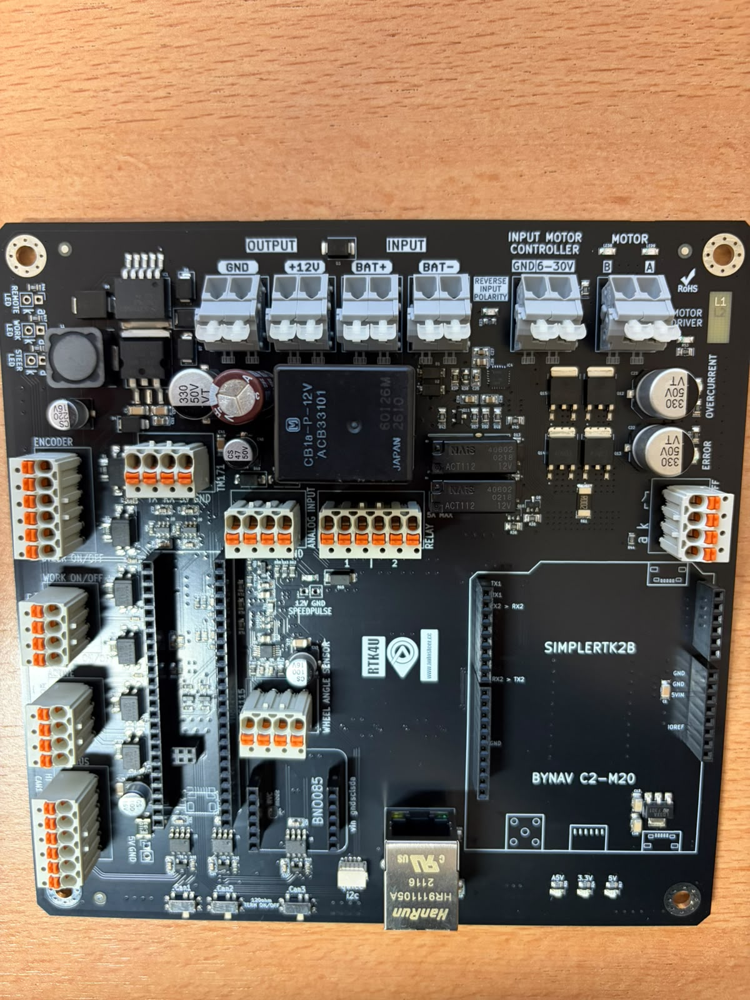

## Contents

- [The Box](#the-box)
  - [Opening the box](#opening-the-box) · [Cables](#cables) · [Antenna](#antenna)
- [Installing the PCB](#installing-the-pcb)
  - [Dual system](#dual-system-2-antennas) · [Single system](#single-system-1-antenna-and-imu)
- [PCB Details](#pcb-details)
- [Technical Data](#technical-data)
- [Connections](#connections)
  - [Overview](#connection-overview)
  - [USB](#usb-port) · [Power supply](#power-supply-of-the-pcb) · [Power switch](#power-switch-onoff) · [Inputs](#inputs)
  - [Steering angle sensor](#steering-angle-sensor) · [Analog inputs](#12-v-and-5-v-analog-inputs) · [CAN bus](#can-bus)
  - [Compass and tilt sensor](#compass-and-tilt-sensor) · [GNSS receiver](#gnss-receiver) · [Ethernet](#ethernet-port)
  - [Relays](#relays)
- [Ethernet Settings on the PC](#ethernet-settings-on-the-pc)
- [AgIO Network Settings](#agio-network-settings)
  - [Wi-Fi drops](#wi-fi-drops-as-soon-as-agio-connects)
- [Web Interface](#web-interface)
  - [DUAL GNSS](#dual-gnss) · [MCP23017 Relay Card](#mcp23017-relay-card) · [Speed Pulse](#speed-pulse) · [IMU](#imu)
  - [Motor Controller](#motor-controller) · [Motor Test](#motor-test) · [CAN bus steering](#can-bus-steering) · [Analog 12V](#analog-12v)
  - [PCB Relay Function](#pcb-relay-function) · [Kick PWM and Kick Duration](#kick-pwm-and-kick-duration) · [Gyro WAS (in development)](#gyro-was-in-development)
- [Firmware Update](#firmware-update)

## The Box

The PCB comes pre-wired in a box.

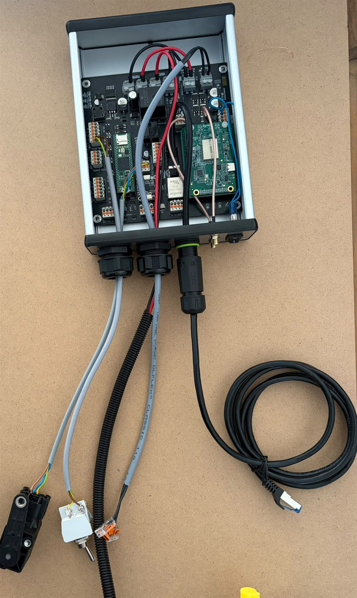

### Opening the box

Undo one side and the top screws, then slide the lid off.

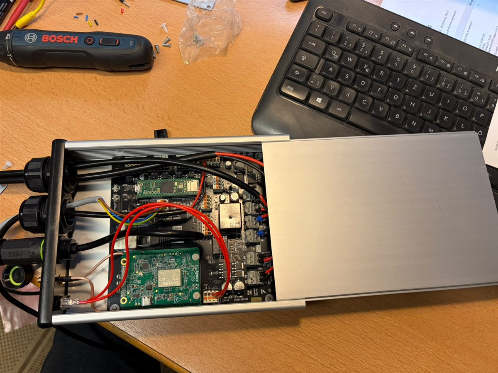

### Cables

#### PCB power cable: black, 2 × 2.5 mm²

Best connected to the 3-pin power socket. Fit the fuse right after the plug.

#### Motor cable: black, 2 × 1.5 mm²

The polarity at the motor does not matter – the direction can be reversed in AgOpenGPS (**Invert motor** in the
steering settings, see [Installing the PCB](#single-system-1-antenna-and-imu)).

The PCB has a current sensor. Enable it as needed in the steering settings under **Current sensor steering**. If
the motor draws too much current, steering is disengaged.

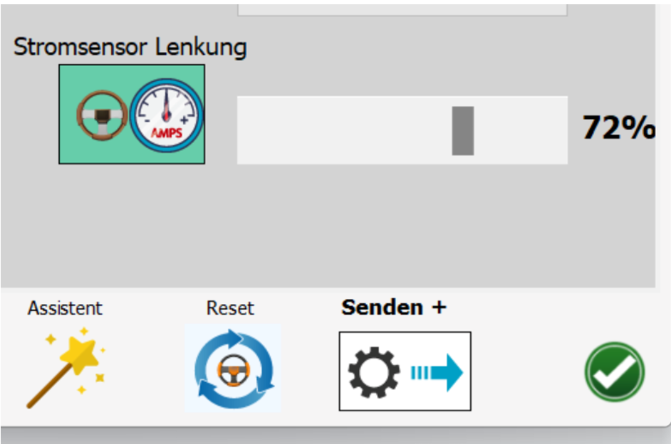

#### On/off switch

Turns the PCB on. When not in use, it is best to disconnect the PCB from the tractor via the power cable.

#### Steering angle sensor: grey, 3 × 0.5 mm²

- **Brown:** 5 V
- **Green-yellow:** GND
- **Blue:** sensor signal (0–5 V)

The direction is reversed in the steering settings with **Invert WAS**.

#### Engage steering: black, 2 × 0.5 mm²

Can be used with a switch or a push button; set it in the steering settings under **External engage**:

- **Switch** (latching): on = steering on, off = steering off
- **Button** (momentary): each press toggles – press once for on, again for off

### Antenna

- With two antennas, select **Dual** under **Antenna Type** in AgOpenGPS. If the tractor drives the wrong way round,
  simply swap the two antenna cables.
- Minimum distance for dual: 1 m – the larger, the better.
- Avoid vibrations and do not route the cables past the exhaust.

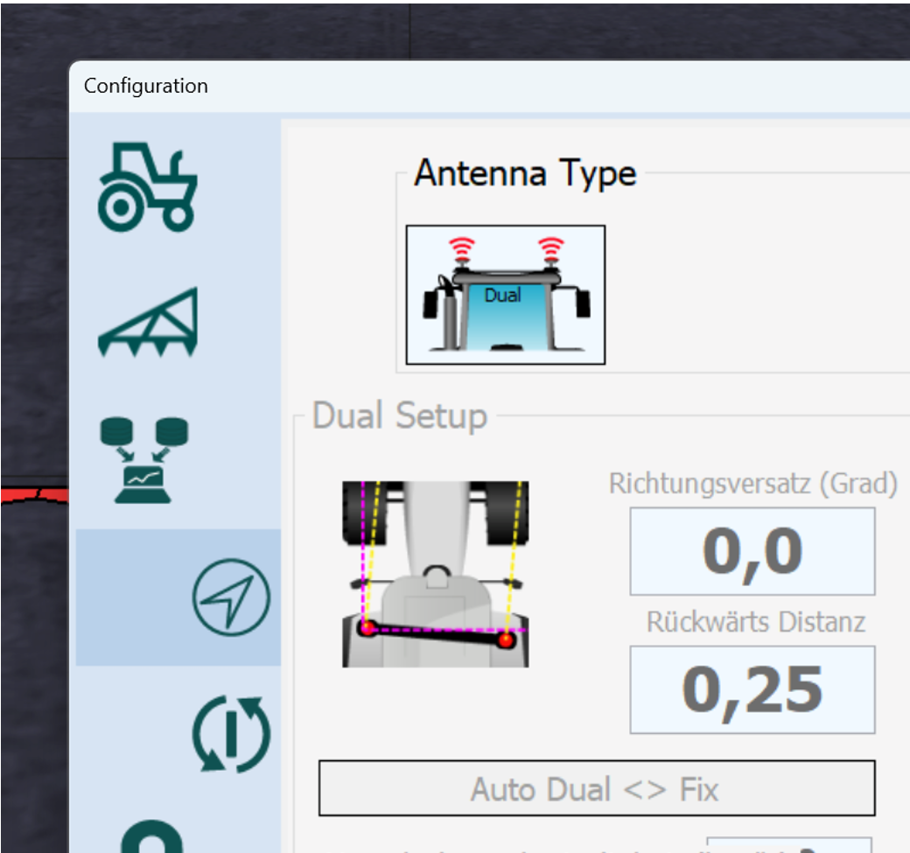

## Installing the PCB

### Dual system (2 antennas)

The position of the PCB in the tractor does not matter.

### Single system (1 antenna and IMU)

The PCB must be mounted reasonably level and at a right angle to the driving direction. The orientation does not
matter – it is set in AgOpenGPS afterwards.

In the **steering settings** (the blue arrow enlarges the window), choose the X or Y axis under **IMU axis**:

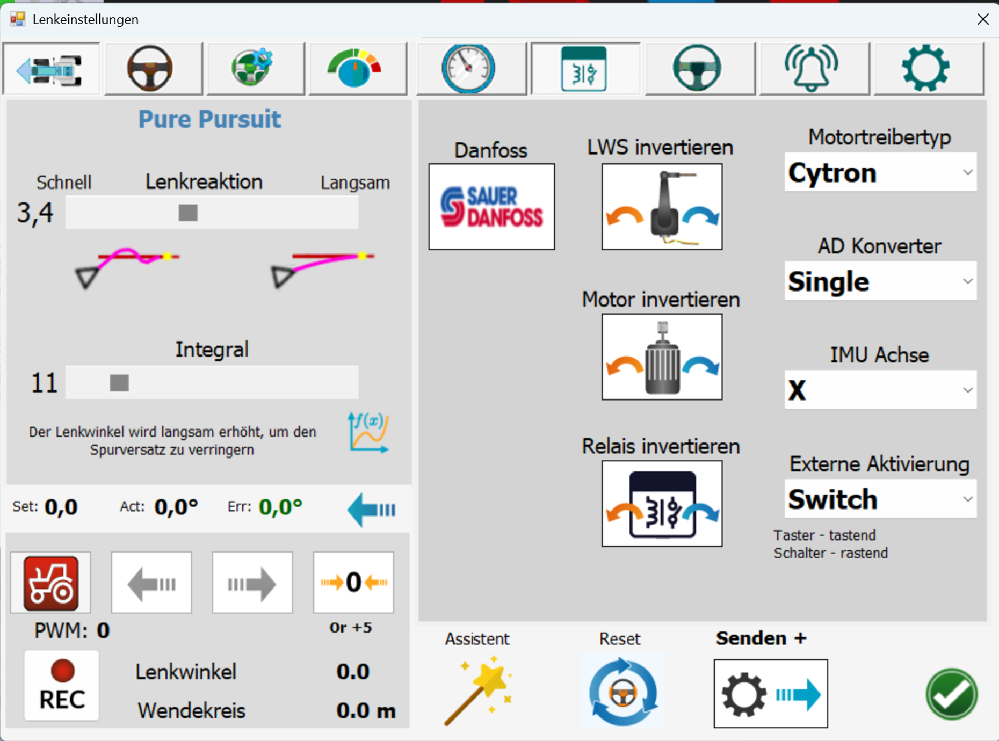

Zero (level) and inverting the roll are set in **Configuration** in the IMU section (**Remove offset**,
**Calibrate IMU**, **Invert IMU**):

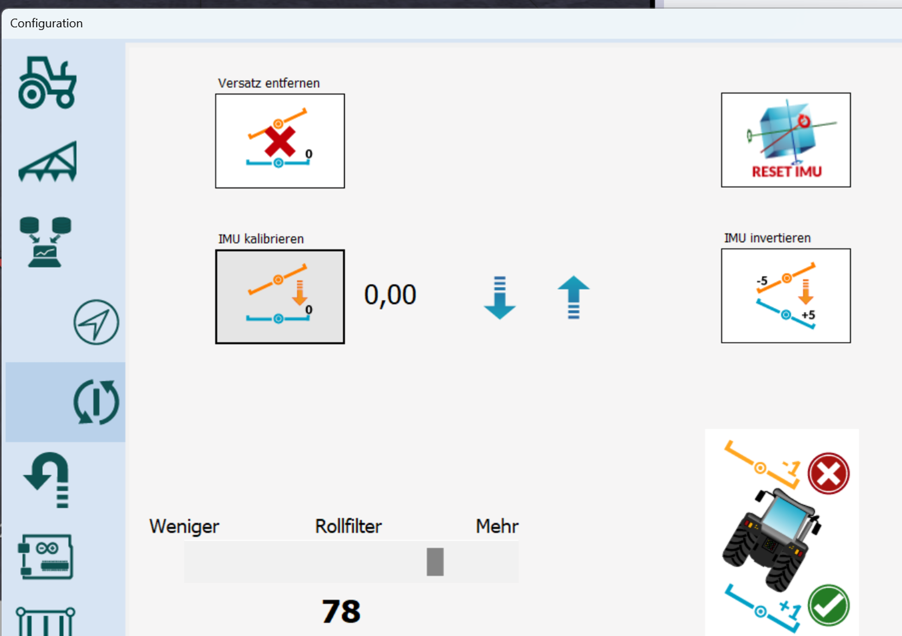

## PCB Details

- Arduino Teensy 4.1 with Ethernet
- ADS1115 (soldered)
- Sockets for Ardusimple simpleRTK2B, Septentrio and Bynav
- Integrated motor controller
- Reverse polarity protection
- Optocoupler-protected inputs
- I2C via Wago and QWIIC connectors
- 2 relays
- Web interface

## Technical Data

**Supply voltage:** 12–15 V, fuse with 10 A directly after the plug on the tractor.

**Inputs**
- On/off switch
- 4 digital inputs (3 + 1 interrupt), potential-free (GND to GND) – switches for steer, work, remote
  (currently without function) and encoder
- 2 × 12 V inputs for steer and work
- Steering angle sensor
- 1 × analog 0–5 V
- 1 × analog 0–12 V

**Outputs**
- 5 V, max. 800 mA
- 12 V (input voltage), max. 2 A
- Output for the motor controller (= input voltage)
- 3 × CAN bus
- Ethernet for operation
- 2 relays
- I2C bus

**Electrical data**

| | |
|---|---|
| Supply | 12–15 V DC |
| Current draw | 200 mA at 13.0 V (without motor) |
| Outputs | 5 V DC and 12 V DC |
| Dimensions (L × W × H) | 160 × 120 × 35 mm |
| Operating temperature | −40 °C to +85 °C |
| Storage temperature | −40 °C to +85 °C |
| Standards | RoHS compliant |

## Connections

### Connection overview

Labels as printed on the PCB.

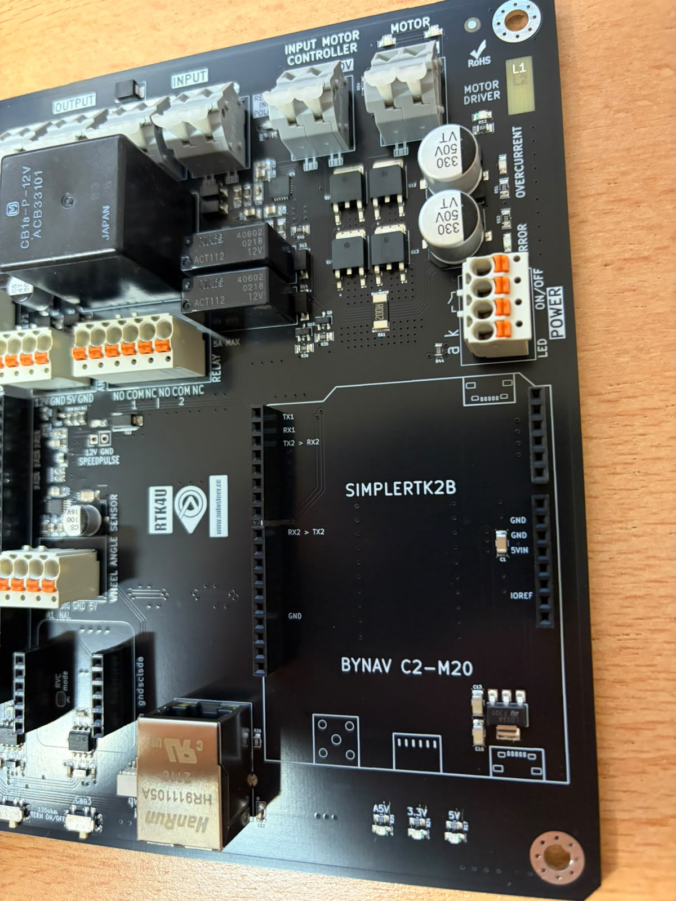

| Connector | Terminals | Function |
|---|---|---|
| INPUT | BAT+ · BAT− | 12 V supply from the tractor (fuse 10 A). LED **REVERSE INPUT POLARITY** = reversed polarity |
| OUTPUT | GND · +12V | switched 12 V after the relay (jumper to INPUT MOTOR CONTROLLER) |
| INPUT MOTOR CONTROLLER | GND · 6–30V | motor controller supply |
| MOTOR | B · A | steering motor or proportional valve; LEDs show the direction, plus LEDs **OVERCURRENT** and **ERROR** |
| POWER | ON/OFF · LED (a, k) | power switch (jumper) and LED |
| RELAY | NO · COM · NC (relay 1 and 2) | 2 relays, max. 5 A |
| ANALOG INPUT | 12V · GND · 5V · GND | 0–12 V and 0–5 V analog input |
| TM171 | TX · RX · 5V · GND | serial port for the TM171 compass/tilt sensor (firmware 1.3.7 and later, see [IMU](#imu)) |
| WHEEL ANGLE SENSOR | DIF (A1) · SIG · GND · 5V | steering angle sensor |
| SPEEDPULSE | 12V · GND (solder pads) | speed signal |
| BNO085 | socket, solder jumper RVC mode | compass and tilt sensor |
| qwiic i2c | vin · gnd · scl · sda | I2C (e.g. MCP23017 relay card) |
| SIMPLERTK2B / BYNAV C2-M20 | socket | GNSS receiver |
| Ethernet | RJ45 | network to AgOpenGPS |
| Status LEDs | A5V · 3.3V · 5V | supply voltages on the PCB |

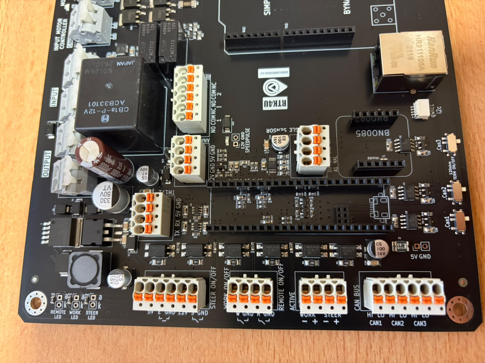

| Connector | Terminals | Function |
|---|---|---|
| STEER ON/OFF | 5V · E · GND · 12V · S · GND | E–GND = encoder input, S–GND = steer switch (potential-free), 12V = 12 V output (close the solder jumper on the back of the PCB) |
| WORK ON/OFF · REMOTE ON/OFF | W · GND · R · GND | W–GND = work switch, R–GND = remote (currently without function), potential-free |
| ACTIVE | WORK − + · STEER − + | switch work and steer with 12 V (optocoupler) |
| CAN BUS | HI · LO for CAN1, CAN2, CAN3 | 3 CAN buses |
| Can1 · Can2 · Can3 | slide switch "120ohm TERM ON/OFF" | termination resistor per CAN bus |
| REMOTE LED · WORK LED · STEER LED | a · k (solder pads) | connection for external LEDs |
| 5V GND | solder pads | 5 V output |

### USB port

The USB port on the Teensy is only needed for programming. Firmware updates also work over Ethernet
(see [Firmware Update](#firmware-update)).

### Power supply of the PCB

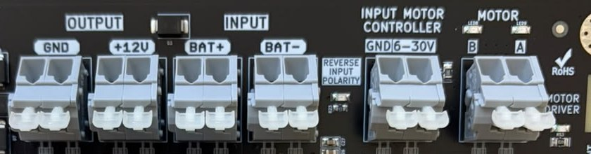

12 V from the tractor (the tractor voltage is between 12 and 14 V), **fuse with 10 A**.

- The fuse always sits right at the plug and protects the cable. If you take power directly from the battery, the
  fuse goes there; with the 3-pin tractor socket, right after the plug.
- Labels **INPUT BAT+** and **BAT−**.
- The jumper from **Output** to **Input M** powers the motor controller once the relay has switched.
- A 12 V to 24 V step-up converter can be fitted between Output and Input motor controller to run the motor at
  24 V (turns faster).
- **Motor A and B** is the connection for the steering motor. A 0–12 V proportional valve can also be connected here
  (+ of each side to motor A and B, ground from the tractor).
- The motor controller is enabled by the Teensy. There is no braking function at standstill.

### Power switch ON/OFF

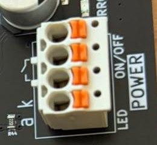

The ON/OFF jumper switches the board on – the black relay closes and the motor controller and the 12 V output get
power. An external switch can be fitted here. Next to it is a connection for an LED.

### Inputs

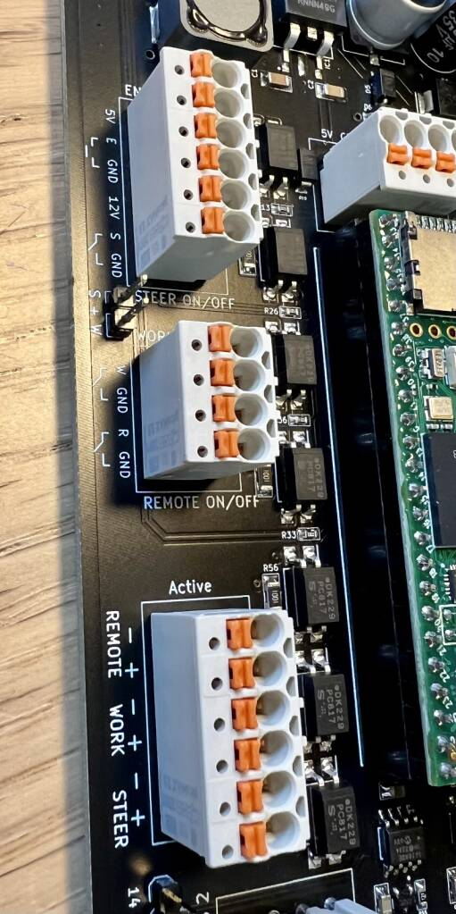

The switches on **S**, **W** and **R** are potential-free and switch against **GND**. To switch work and steer with
12 V, use the **ACTIVE** terminals (see below). **R** (remote) currently has no function, **E**–**GND** is the encoder
input.

#### Steer on/off – S to GND

Switch to engage steering (potential-free, ground to ground). This contact enables steering. It can, for example,
be routed through a micro switch on the motor that turns the motor off when it is swung away.

**The switch must be set to "Switch" in the AgOpenGPS module configuration!**
A green dot = steering active = switch closed.

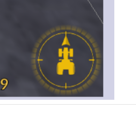

Tractor icon: **green** steering engaged · **red** steering off · **orange** no guidance line

#### Work on/off – W to GND

Switch to enable recording (potential-free, ground to ground). Must be set accordingly in the AgOpenGPS
configuration.

#### 12 V inputs for work/steer (ACTIVE)

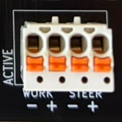

To enable work or steer with a 12 V signal, apply the voltage to **WORK − +** or **STEER − +** (+ to +, − to −).
**Caution: always use 12 V and GND from the external switch!**

### Steering angle sensor

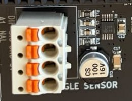

- **5 V** and **GND** supply the sensor, the sensor signal goes to **Signal**.
- With an existing steering angle sensor, check the signal with a multimeter first: **maximum 5 V** – a range of
  0.5–4.5 V is typical.
- Most sensors have a specific measuring range (usually marked right at the connector or exactly opposite) – check
  that beforehand too.
- With factory-fitted sensors you only need GND and signal from the sensor: signal to **Signal**, GND is connected
  to **A1**. The software then reads differentially (ADS1115 A/D converter).

### 12 V and 5 V analog inputs

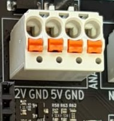

- Pressure sensor 0–5 V
- 12 V input 0–12 V

The inputs go to the Teensy via voltage dividers. The function of the 12 V input (steer switch, work switch,
pressure sensor) and the switching threshold are set in the web interface.

**Current sensor:** connected directly to the motor controller and can be enabled in AgOpenGPS.

### CAN bus

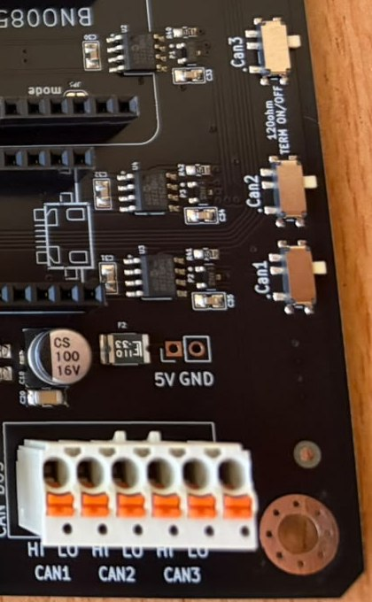

Each CAN bus has a 120 Ω termination resistor on the PCB. It is switched on with the slide switch **Can1**, **Can2**
or **Can3** ("120ohm TERM ON/OFF") next to the Ethernet socket. For Allynav motors, switch on the termination on CAN2.

### Compass and tilt sensor

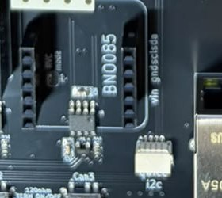

UART in **RVC mode** – supported and the default for the BNO085. If the compass is ordered with mounting, it is
permanently fitted on the PCB.

Instead of the BNO085, a TM171 (SYD Dynamics) can be connected to the **TM171** connector. It is selected in the web
interface under [IMU](#imu).

Next to it is the QWIIC connector (**qwiic i2c**) for I2C devices, e.g. the relay card.

### GNSS receiver

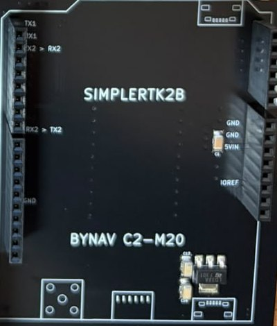

UNO-format socket for Septentrio or F9P (single). An adapter board is supplied for Bynav receivers.

### Ethernet port

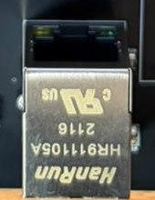

Connect the network cable here.

### Relays

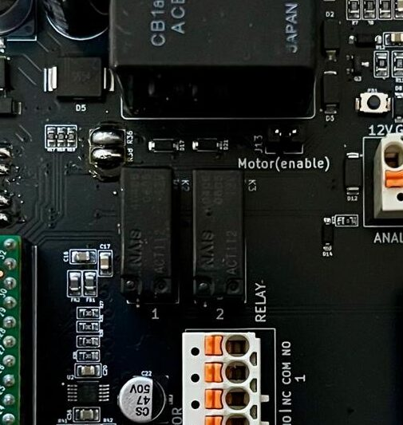

Three terminals per relay, max. 5 A:

- **COM**: input for the voltage to be switched
- **NO** (normally open): gets the voltage when the relay is energized
- **NC** (normally closed): gets the voltage when the relay is released

COM is switched between NC and NO.

The function of the two relays is set in the web interface under **PCB Relay 1 Function** and **PCB Relay 2
Function** (see [PCB Relay Function](#pcb-relay-function)).

## Ethernet Settings on the PC

With a router, nothing needs to be set for now. With a direct connection to a tablet, the IP address of the
tablet's Ethernet adapter must be set to a fixed value. See also
[AgOpenGPS Ethernet Setup](https://docs.agopengps.com/software/05.-Ethernet-Setup/).

Right-click the network icon in the taskbar → **Network and Internet settings**:

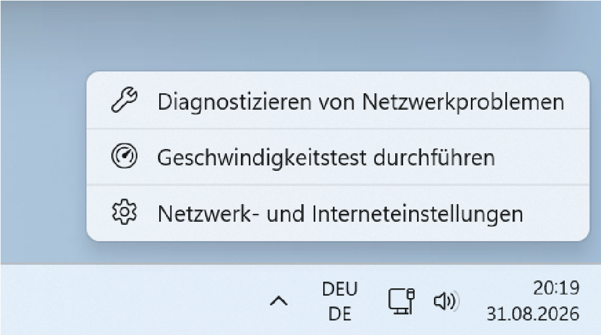

Choose **Ethernet**, then click **Edit** next to **IP assignment**:

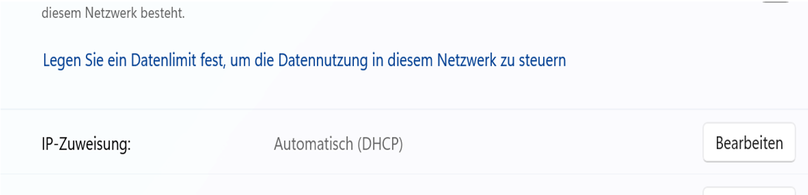

Choose **Manual** and switch on **IPv4**:

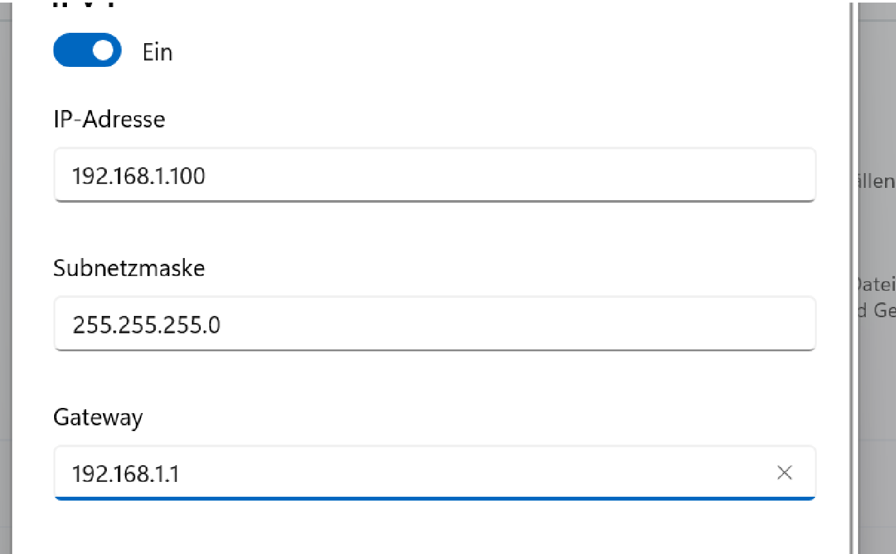

- **IP address:** 192.168.1.100 – this is the tablet's address
- **Subnet mask:** 255.255.255.0 – if Windows asks for the **subnet prefix length** instead, enter 24
- **Gateway:** 192.168.1.1

## AgIO Network Settings

In AgIO, click the network icon (shows **Off**):

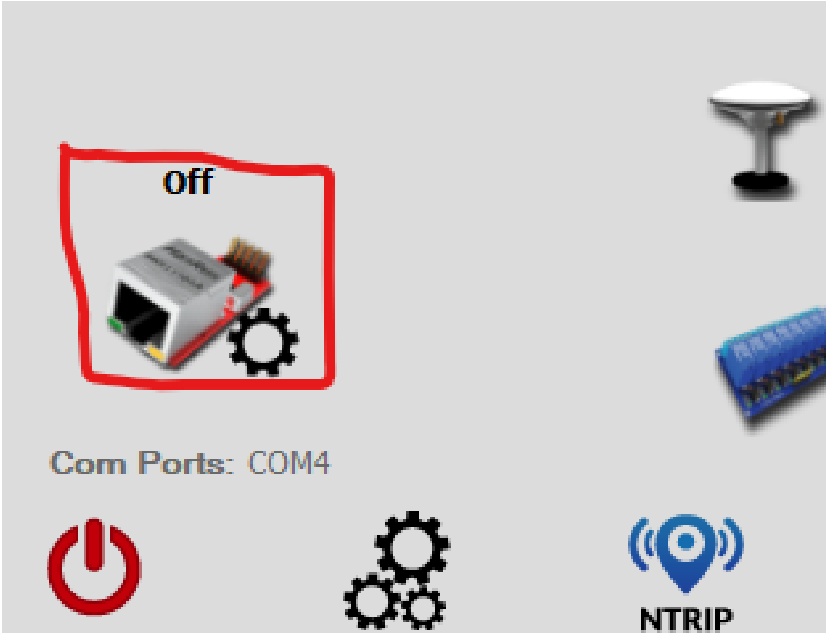

In the **Ethernet Configuration** window, click **UDP On** (turns green), then the green tick:

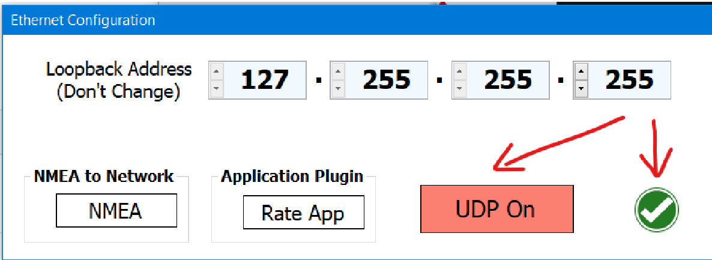

The network icon is now green, with the PC's IP addresses above it. Click the network icon again:

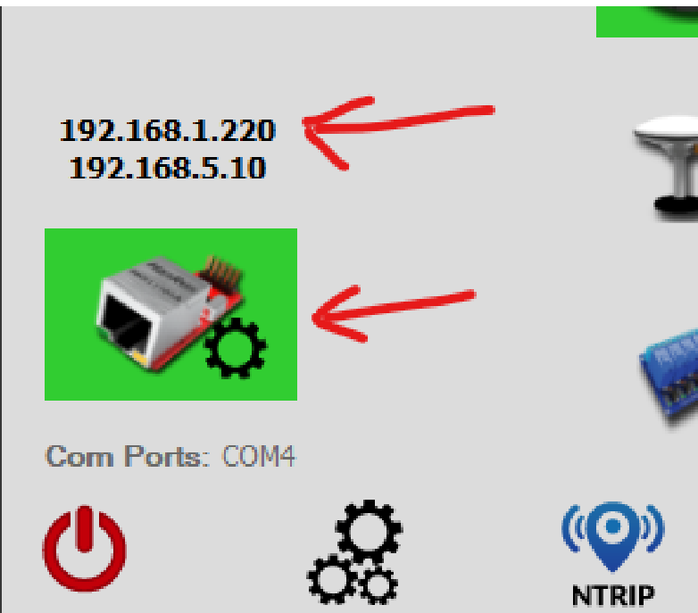

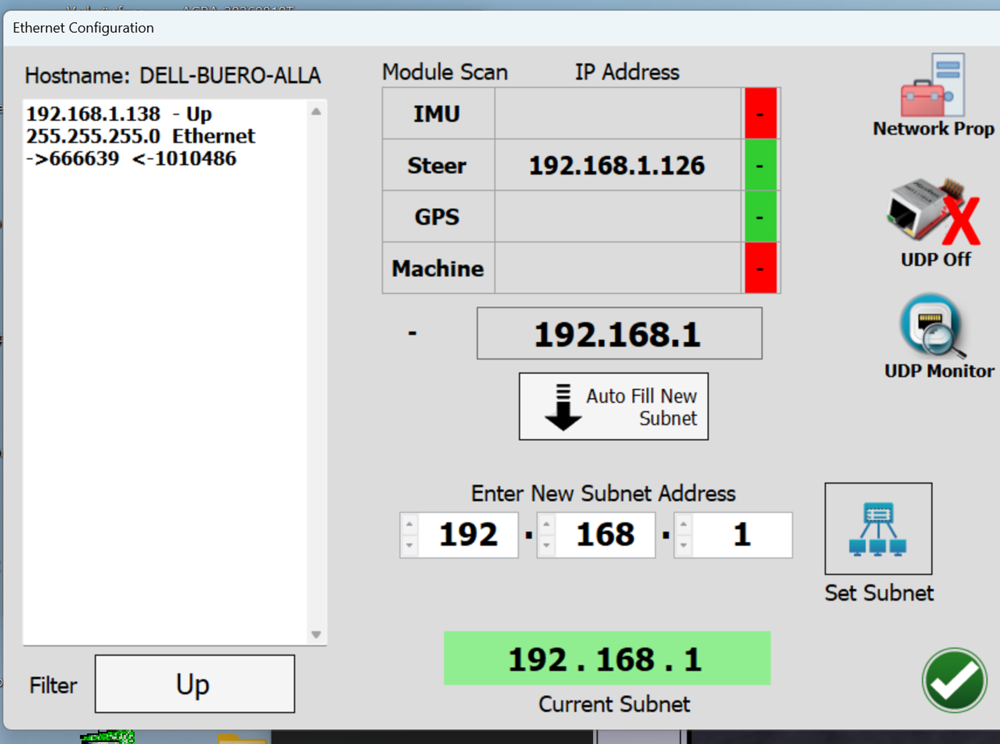

- **IMU** (only for single with IMU), **Steer** and **GPS** should be green. Steer shows the PCB's IP address.
- **Current Subnet** should match the network set on the PC before. Otherwise enter the address under
  **Enter New Subnet Address** and click **Set Subnet** – the subnet is then sent to the PCB.

The PCB is set to **192.168.1.126** at the factory, so the PC needs an address 192.168.1.xxx.

For further PCB settings (motor, relays etc.) see [Web Interface](#web-interface).

### Wi-Fi drops as soon as AgIO connects

Windows prefers the wired connection over Wi-Fi and turns Wi-Fi off. AgOpenGPS needs both, though. The fix is a small
change in the Windows registry: download the file
[Network-Drop-Fix.reg](https://raw.githubusercontent.com/AgOpenGPS-Official/Boards/main/Misc/Network-Drop-Fix.reg)
and import it by double-clicking, or make the change yourself following
[these instructions](https://discourse.agopengps.com/t/toughpad-book/399/110).

## Web Interface

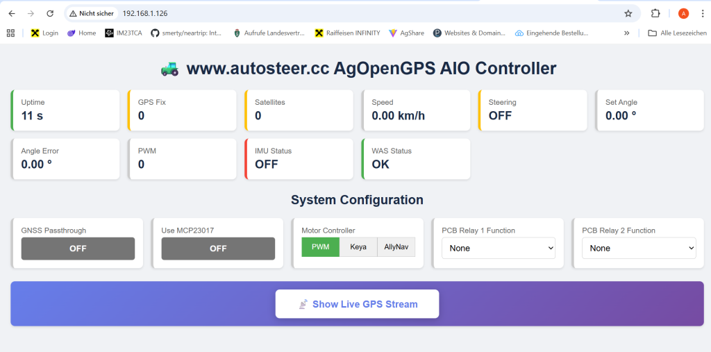

Open the controller's IP address in the browser (`http://<controller-IP>`). Motor, CAN brand, relays, inputs etc. are
set there, and live values are shown. The **Anleitung** (manual) button leads to this page. Settings take effect
immediately and are kept after switching off.

Use the web interface only **at standstill** and close it afterwards. From firmware 1.3.8 it is locked while driving
(above 0.5 km/h) and while steering is engaged: a notice is shown instead of the page and settings cannot be
changed. After stopping and disengaging steering it continues by itself.

### DUAL GNSS

- **On:** all data from the GNSS receiver is **passed through 1:1 to AgOpenGPS** (UDP port 9999) without processing in
  the controller. For receivers that supply position and heading themselves (e.g. dual-antenna receivers).
- **Off:** the controller reads GGA/VTG from the receiver (e.g. F9P single) and sends them to AgOpenGPS together with
  compass and roll (BNO085 or TM171).

### MCP23017 Relay Card

Enables the optional **relay card for 8 sections** (MCP23017 I2C port expander). Relays 1–8 follow sections 1–8 from
AgOpenGPS. If the card is not found at startup, the live view shows "MCP23017 NOT FOUND".

### Speed Pulse

Outputs the speed from AgOpenGPS as a **pulse signal** on the **SPEEDPULSE** solder pads, e.g. for the radar input
of a sprayer or seed drill computer (firmware 1.3.6 and later).

- **130 pulses per meter** (square wave), frequency = km/h × 36.1
- Examples: 5 km/h = 181 Hz, 10 km/h = 361 Hz, 20 km/h = 722 Hz
- Below 0.1 km/h or without a connection to AgOpenGPS (longer than 1 s), no signal is output.
- On the device evaluating the signal, set **130 pulses/m** (or 13,000 pulses/100 m).
- To check: multimeter with frequency measurement (Hz) on SPEEDPULSE and GND, set a speed in the AgOpenGPS simulator.

### IMU

Selects the compass/tilt sensor (firmware 1.3.7 and later). The change takes effect immediately.

- **BNO085** (default): socket on the PCB, RVC mode.
- **TM171**: on the **TM171** connector (TX · RX · 5V · GND).

The live view shows under **IMU Status** which sensor is selected and whether it delivers data (e.g. "TM171 OK").
Heading, roll and pitch go to AgOpenGPS as with the BNO085; IMU axis, zero and invert are set in AgOpenGPS (see
[Single system](#single-system-1-antenna-and-imu)). With **DUAL GNSS on**, the IMU is not used.

The TM171 must be configured once beforehand with the Windows program **ImuAssistant** (USB-C on the TM171):

- UART on, **115200** baud, output rate **100 Hz**
- output only **Roll/Pitch/Yaw (RPY)**, raw data and status off
- then click **Save Settings**, otherwise the setting is lost after switching off

### Motor Controller

| Setting | Motor | Connection |
|---|---|---|
| PWM | integrated motor controller (DC motor or proportional valve) | Motor A/B |
| Keya | Keya steering motor | CAN2, **250,000 baud** |
| AllyNav | Allynav steering motor | CAN2, selectable baud rate: **250,000 for the blue**, **500,000 for the red** motor |
| CAN-Bus | tractor steering valve via CAN | see [CAN bus steering](#can-bus-steering) |

With Keya and AllyNav, the baud rate selection and the motor test appear. The live view shows whether the motor was
detected, error messages, position and target and actual speed. The motor current is sent to AgOpenGPS and can be used
there as a current sensor to disengage steering when the driver turns the wheel.

### Motor Test

Only with Keya and AllyNav. The buttons **◀ Links 1s** and **Rechts 1s ▶** (left/right) switch the motor on, turn it
**for 1 second at about 10 %** in the chosen direction and switch it off again. This way you can check the
connection, baud rate and direction without starting AgOpenGPS.

The test only works with auto steering off. If steering engages during the test, it takes over immediately.

### CAN bus steering

Choose motor controller **CAN-Bus**, then the tractor under **CAN-Bus Brand**. The **Anschlüsse** (connections) card
shows which CAN buses are used:

| Brand | Connections |
|---|---|
| Claas | CAN3 (V-Bus): steering, engage, work switch |
| Valtra/MF | CAN3 (V-Bus): steering, engage · CAN1 (K-Bus): engage button, rear hitch |
| CaseIH | CAN3 (V-Bus): steering, engage · CAN1 (K-Bus): engage, rear hitch |
| Fendt | CAN3 (V-Bus): steering · CAN1 (K-Bus): armrest buttons · CAN2 (ISO bus): engage |
| JCB | CAN3 (V-Bus): steering, engage |
| FendtOne | CAN3 (V-Bus): steering (500 kbaud) · CAN1 (K-Bus): engage (500 kbaud) |
| Lindner | CAN3 (V-Bus): steering, engage |
| AgOpenGPS | CAN3 (V-Bus): steering + steering angle feedback |
| Cat MT-Late | CAN3 (V-Bus): steering, engage, reverse detection · CAN1 (K-Bus): engage |
| Cat MT-Early | CAN3 (V-Bus): steering, engage, reverse detection · CAN1 (K-Bus): engage |
| Deutz | CAN3 (V-Bus): steering · CAN1 (K-Bus): engage, joystick |

- Baud rate 250 kbaud, only FendtOne 500 kbaud – set by the controller itself.
- The steering angle sensor is still needed; only with **AgOpenGPS** does the steering angle come via CAN.
- "Engage" = switch steering on/off at the tractor (tractor button/joystick); "work switch"/"rear hitch" pass the
  work switch on to AgOpenGPS.
- The live view shows valve status (Valve Ready), engage, work position, valve pressure and current.
- **Reset CAN** restarts the CAN buses. **CAN Debug** shows the CAN messages live (for troubleshooting).
- Termination resistors depending on the tractor wiring – see [CAN bus](#can-bus).

### Analog 12V

The 0–12 V analog input can take on one of four functions. The measured voltage is shown in the live view.

| Setting | What happens |
|---|---|
| None | no function, voltage display only |
| Steer Switch | steer switch via a 12 V signal: above the **threshold**, the switch counts as pressed. Replaces the steer switch (S) in the message to AgOpenGPS. |
| Work Switch | work switch via a 12 V signal (e.g. hitch or PTO signal): above the **threshold** = work on. Replaces the work switch (W). |
| Pressure Sensor | the input is used as a pressure sensor (e.g. steering pressure). If the value rises above the pressure threshold set in AgOpenGPS, steering disengages (driver turns the wheel). Enable the pressure sensor in AgOpenGPS. |

The **threshold** (0–12 V in 0.1 V steps) appears with Steer Switch and Work Switch. It is best to read the voltage
in the on and off state in the live view and set the threshold in between.

### PCB Relay Function

For each of the two relays on the PCB you set when it switches on:

| Setting | Relay switches on when … |
|---|---|
| None | never (relay off) |
| Autosteer | auto steering is engaged |
| Tramline | AgOpenGPS reports a tramline |
| Hitch Up | AgOpenGPS reports "raise hitch" |
| Hitch Down | AgOpenGPS reports "lower hitch" |
| Section 1 | section 1 is on in AgOpenGPS |
| Section 2 | section 2 is on in AgOpenGPS |
| Geo Stop | AgOpenGPS reports a geo stop |

### Kick PWM and Kick Duration

Only visible with motor controller **PWM** (integrated motor controller, Cytron or IBT-2).

Some steering motors do not start at low PWM (breakaway torque), or they hang briefly when the direction changes. The
kick gives a short, stronger pulse at every direction change:

- **Kick PWM** (0–255): minimum PWM during the pulse. **0 = kick off** (default).
- **Kick duration** (0–255 ms, in 5 ms steps): how long the minimum PWM applies after the direction change. 0 = off.

If the controlled PWM is higher anyway, it stays unchanged. A direction change only counts if it persists for two
control cycles (50 ms) – so sensor noise around the setpoint does not cause a permanent kick.

**Recommendation: generally leave the kick off (Kick PWM 0).** Too much kick causes jitter around the line.

### Gyro WAS (in development)

> **In development – not for normal operation.** Off by default.

Instead of a steering angle sensor, a gyro sensor on the steering knuckle (Forsense FSS-G200, CAN) is to determine
the steering angle together with the GNSS heading. The **Gyro WAS** switch enables the function:

- **Off** (default): the controller does not look for a gyro, CAN3 stays free, steering uses the steering angle
  sensor.
- **On**: the gyro is searched for on CAN3 and additional displays appear (gyro, heading, gyro angle, steering angle
  source, recording). The steering angle source can be switched between WAS and gyro. If the gyro angle is invalid
  while the source is gyro, steering disengages.

Cannot be used together with a CAN steering valve (CAN3 is then in use). Only switch with steering disengaged.

## Firmware Update

Via the web interface in the **Firmware** section – see [Update](../../README.md#update).

From firmware 1.3.8, **Update suchen** (check for updates) shows a list of all versions: installed (green), newer
(blue), beta (orange, test version) and older (grey). **Installieren** (install) can load any version, including an
older one if a new version causes problems. The settings are kept.
